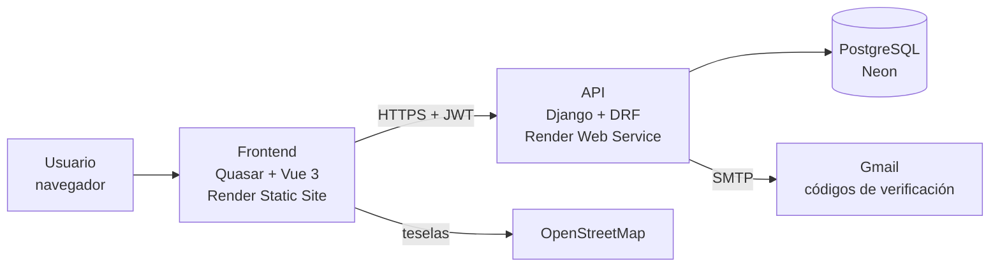

# Arquitectura

Este documento explica cómo está armado Raite por dentro y por qué se tomaron ciertas decisiones durante su desarrollo. Para conocer los detalles de la base de datos se puede consultar [`RaiteDocs/Modelo-ER.md`](RaiteDocs/Modelo-ER.md), y para ver la lista completa de endpoints, [`RaiteDocs/API.md`](RaiteDocs/API.md).

## Contenido

1. [Visión general](#1-visión-general)
2. [Backend](#2-backend)
3. [Frontend](#3-frontend)
4. [Reglas de negocio que influyen en el diseño](#4-reglas-de-negocio-que-influyen-en-el-diseño)
5. [Decisiones técnicas](#5-decisiones-técnicas)
6. [Fuera de alcance](#6-fuera-de-alcance)

## 1. Visión general

Raite se compone de dos partes que se publican por separado y se comunican por internet: una API, que guarda la información y aplica las reglas, y una aplicación web, que es la que usan los estudiantes desde el navegador.

Cada pieza tiene una función clara, entre las cuales están:

- **Frontend** (`Front_Raite/`): la interfaz, la navegación, la sesión del usuario y el mapa.
- **API** (`Back_Raite/`): las reglas del negocio, el acceso con sesión, los permisos y el guardado de los datos.
- **PostgreSQL:** la base de datos, que además bloquea filas para controlar el cupo de los viajes.
- **Gmail (SMTP):** el envío del código con el que se verifica el correo.

## 2. Backend

El backend es un proyecto de Django dividido en seis aplicaciones, cada una dedicada a una parte del problema, como lo son:

- `accounts`: usuarios, vehículos, códigos de verificación e inicio de sesión.
- `locations`: campus, puntos de referencia y el cálculo de cercanía.
- `rides`: viajes, solicitudes, búsqueda e historial.
- `notifications`: los avisos dentro de la aplicación.
- `ratings`: las calificaciones entre conductor y pasajero.
- `reports`: los reportes de comportamiento inadecuado.

### Organización de cada app

Dado que todas las apps siguen el mismo orden, resulta sencillo encontrar dónde está cada cosa. Dicho orden se describe a continuación:

- `models.py` y `models_choices.py`: definen los datos y validan un registro por separado.
- `services.py`: contiene las reglas que involucran varios registros. Son funciones que se ejecutan dentro de una transacción y que crean los avisos correspondientes.
- `serializers.py`: da forma a lo que entra y sale de la API.
- `views.py` y `urls.py`: reciben las peticiones y dejan el trabajo a los servicios, por lo que se mantienen cortas.
- `admin.py`: registra los modelos en el administrador de Django.
- `tests/`: guarda las pruebas, creadas con fábricas de datos.

### Acceso y permisos

El sistema usa un modelo de usuario propio, donde el inicio de sesión se hace con el **correo** y no con un nombre de usuario. El acceso se controla con tokens JWT: el de acceso dura 30 minutos y el de renovación, un día. Por defecto, todo el API exige sesión y correo verificado, así que los endpoints públicos deben declararse de manera explícita.

Un solo campo `rol` indica si la persona es administrador, pasajero, conductor o ambos. El rol de administrador no se puede obtener desde el registro público, y la comprobación de quién es dueño de un viaje o de una solicitud se realiza en los servicios.

### Manejo de errores

Los servicios lanzan errores propios del dominio, y un manejador central los traduce en la respuesta que recibe el usuario:

- `ValidationError`: respuesta 400.
- `PermissionDenied`: respuesta 403.
- `Http404`: respuesta 404.
- `Conflicto`: respuesta 409, para cuando el estado de un viaje o solicitud no permite la acción.

### Control del cupo

El hecho de que dos conductores o dos peticiones puedan actuar al mismo tiempo obliga a proteger el cupo. Para lo cual, al aceptar una solicitud, se bloquea la fila del viaje en la base de datos (`select_for_update`), de modo que nunca se acepten más pasajeros de los lugares ofrecidos. Esta lógica se comprueba con una prueba de dos hilos que únicamente funciona en PostgreSQL.

### Viajes vencidos

Un viaje publicado que lleva más de dos horas de retraso se considera "vencido". Dicho estado se calcula en el momento y no se guarda, ello evita tener que actualizar la base de datos constantemente. Un viaje vencido solo puede cancelarse y deja de contar para las búsquedas y los cruces de horario.

## 3. Frontend

La aplicación web está hecha con Quasar, Vue 3 y TypeScript, y su código se reparte en carpetas con una función específica:

- `api/`: una función por cada endpoint de la API.
- `boot/`: la configuración de Axios, que renueva el token automáticamente cuando vence, y la carga inicial de la sesión.
- `stores/`: el estado compartido con Pinia (sesión, catálogos y avisos, que se consultan cada 30 segundos).
- `router/`: las rutas, creadas a partir de los archivos de `pages/`, y la guarda que decide quién puede entrar a cada pantalla.
- `layouts/`: el diseño de las pantallas públicas (entrar, registro y verificar) y el de las pantallas con sesión.
- `pages/`: una página por cada ruta.
- `components/`: piezas reutilizables, como las tarjetas de viaje, el mapa y los selectores.
- `utils/`: funciones de apoyo, como el formato de horas en la zona `America/Ciudad_Juarez`.

Cada página indica en `definePage({ meta })` si es pública, qué papel necesita, su título y a dónde regresa. Si una persona no ha iniciado sesión, se le envía a `/entrar`, y cuando tiene los dos roles, el papel activo cambia según la pantalla que abra. El diseño visual (colores, tipografías y componentes) se describe en [`DESIGN.md`](DESIGN.md).

## 4. Reglas de negocio que influyen en el diseño

Algunas reglas definidas por el equipo condicionan la forma en que se construyó el sistema, como lo son:

1. **Origen por catálogo:** el origen del viaje se elige de una lista de puntos de referencia y nunca por dirección. El punto exacto de recogida lo acuerdan conductor y pasajero después de aceptar el raite.
2. **Lugares definidos por el conductor:** de 1 a 5, según su vehículo.
3. **Compatibilidad:** cada usuario elige "mismo sexo" o "mixto". Si alguien del viaje elige "mismo sexo", todos los integrantes deben tener el mismo valor en el campo `sexo`.
4. **Datos de contacto protegidos:** el teléfono y las placas solo se muestran cuando la solicitud ya fue aceptada.
5. **Acceso institucional:** únicamente entran correos `@alumnos.uacj.mx`, activados con un código de verificación.

## 5. Decisiones técnicas

A continuación se presentan las decisiones más importantes y la razón de cada una:

- **Django y Django REST Framework:** son herramientas maduras que ya incluyen un administrador, por lo que campus, puntos de referencia y reportes se gestionan sin construir una pantalla aparte.
- **PostgreSQL sin PostGIS:** la cercanía entre puntos se calcula con la fórmula de haversine en Python. Dado que el catálogo es pequeño, se evita agregar una herramienta geográfica compleja.
- **Origen por puntos de referencia:** protege la privacidad de los usuarios, pues no se exponen direcciones, y además simplifica la búsqueda.
- **Reglas en `services.py`:** mantiene simples los modelos y las vistas, y reúne las reglas importantes en un solo lugar, lo que facilita probarlas.
- **JWT con renovación y lista negra:** permite iniciar sesión sin guardar sesiones en el servidor y revocar tokens cuando haga falta.
- **Avisos solo dentro de la aplicación:** al consultarse cada cierto tiempo, se evita la complejidad de WebSockets, notificaciones push, Celery o Redis, que no son necesarios para el alcance actual.
- **Leaflet y OpenStreetMap:** ofrecen un mapa sin costo ni claves de API, adecuado para un piloto.
- **Render y Neon:** permiten desplegar de forma automática desde `main` con una configuración declarada en `render.yaml` y una base de datos gratuita administrada (ver [`DEPLOYMENT.md`](DEPLOYMENT.md)).
- **Construcción por capas (modelos, lógica y vistas):** cada capa se termina y se prueba antes de comenzar la siguiente, esto porque así queda una base completa y fácil de entender para quien continúe el proyecto.

## 6. Fuera de alcance

Las funciones siguientes no se desarrollan, a menos que se pidan de forma explícita: los pagos dentro de la aplicación, el seguimiento GPS permanente de los usuarios, los conductores externos a la comunidad universitaria, la cobertura fuera de Ciudad Juárez, la integración con sistemas internos de la UACJ, el servicio profesional tipo Uber o DiDi y el transporte propiedad de la universidad.
