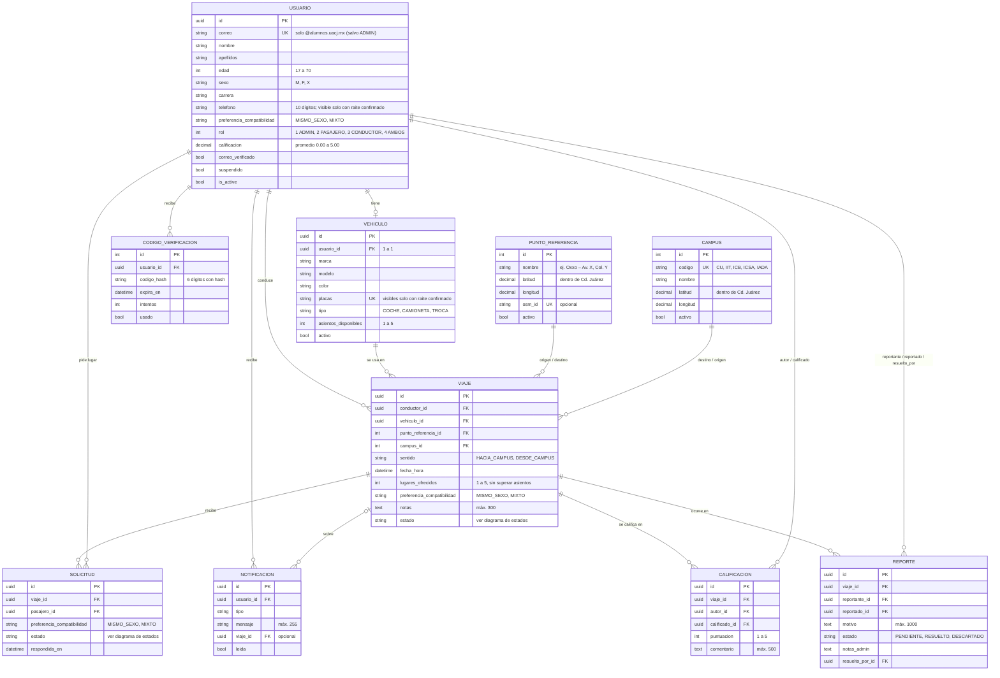
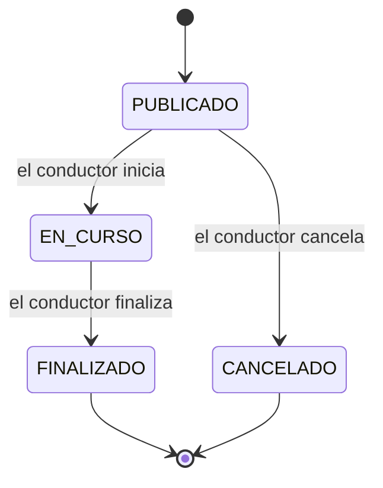
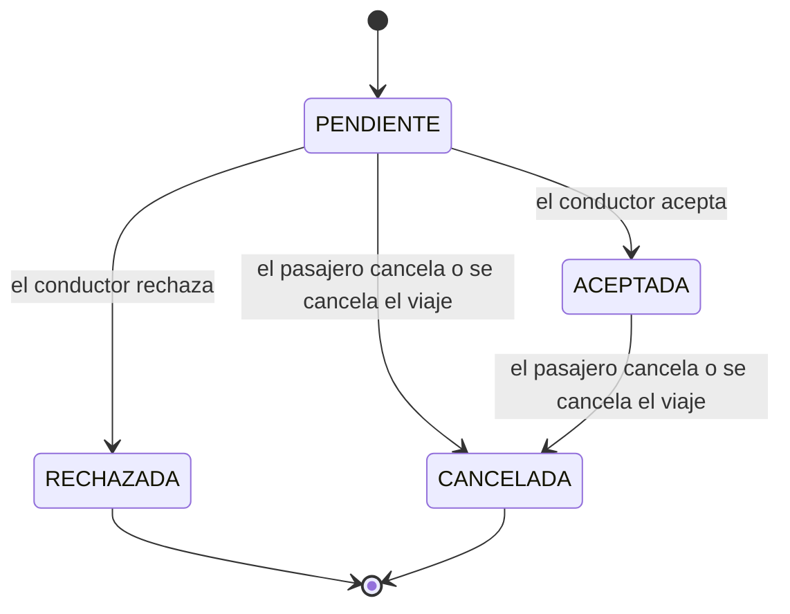

# Modelo entidad-relación (Capa 1)

> Refleja los modelos implementados en `Back_Raite/apps/` (Capa 1, noviembre 2026).
> **Sustituye** a `uml_mermaid_raite.mmd`, `uml_diagram.mmd` y `Raite-Django-Models.md` donde se contradigan:
> esos documentos describen el diseño anterior (el pasajero creaba el raite y el conductor lo "tomaba").
> Aquí el conductor publica el viaje y los pasajeros solicitan lugar, como dicen el SRS y la carta.

## Diagrama

## Estados del viaje

"Lleno" no es un estado: un viaje está lleno cuando sus solicitudes aceptadas igualan `lugares_ofrecidos`.

"Vencido" tampoco es un estado: un viaje `PUBLICADO` cuya hora pasó hace más de 2 h (`VENCIMIENTO_HORAS`) se considera vencido. Solo se puede cancelar, no aparece en búsquedas y no cuenta para cruces de horario. Iniciar solo se permite desde 30 min antes de la hora (`INICIO_ANTICIPACION_MINUTOS`).

## Estados de la solicitud

- Si el conductor no responde, la solicitud sigue `PENDIENTE`.
- Un pasajero solo puede tener una solicitud `PENDIENTE` o `ACEPTADA` por viaje; tras un rechazo o cancelación puede volver a solicitar.

## Reglas que viven en el modelo (Capa 1)

| Regla | Dónde |
|-------|-------|
| Correo `@alumnos.uacj.mx` (el ADMIN queda exento) | `Usuario.clean()` |
| Teléfono de 10 dígitos | validador de `Usuario.telefono` |
| Asientos del vehículo y lugares del viaje: 1 a 5 | validadores + `CheckConstraint` |
| Lugares del viaje ≤ asientos del vehículo; vehículo del conductor y activo | `Viaje.clean()` |
| Viaje nuevo: fecha futura, punto y campus activos | `Viaje.clean()` |
| Coordenadas dentro de Ciudad Juárez | validadores de `latitud` / `longitud` |
| El conductor no solicita lugar en su propio viaje | `Solicitud.clean()` |
| Una solicitud activa por viaje y pasajero | `UniqueConstraint` parcial |
| Calificar solo viajes finalizados, solo conductor ↔ pasajero aceptado, una vez | `Calificacion.clean()` + restricciones |
| Reportar solo entre participantes del viaje | `Reporte.clean()` |

Las reglas de negocio que dependen de varios registros se aplican en la Capa 2 (`services.py` de cada app; ver `RaiteDocs/API.md`):
compatibilidad por sexo, cupo al aceptar, visibilidad de contacto y placas, quién puede cambiar cada estado,
envío del código de verificación y recálculo de `Usuario.calificacion`.
