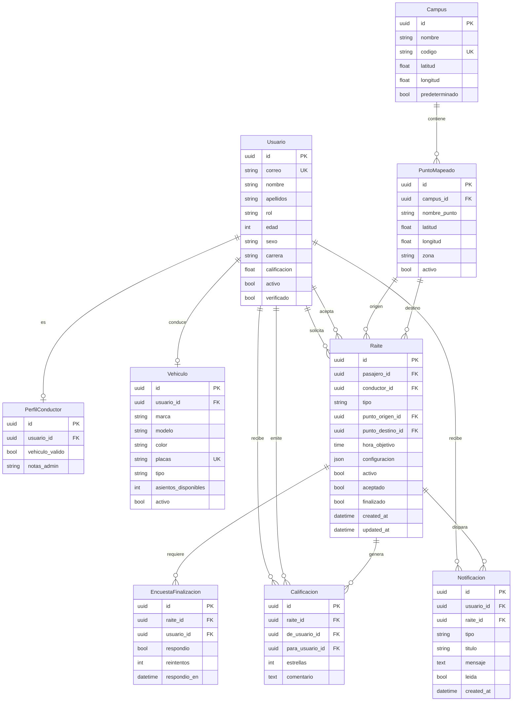

# Raite — Modelos de Dominio

> Especificación de campos, constraints y estados por modelo.
> Derivado de `Raite_layout_disposition_001.md` (Diagrama de Clases + Diagrama de Estados).
> Apps responsables: `accounts`, `vehicles`, `locations`, `rides`, `surveys`, `ratings`, `notifications`.

---

## 1. Diagrama de entidades



---

## 2. `accounts.Usuario`

Hereda de `AbstractUser` y reemplaza el modelo por defecto.

| Campo | Tipo | Null | Notas |
|-------|------|------|-------|
| `id` | `UUIDField` (pk) | no | Cliente genera el UUID |
| `nombre` | `CharField(80)` | no | |
| `apellidos` | `CharField(80)` | no | |
| `correo` | `EmailField(unique)` | no | `USERNAME_FIELD = 'correo'`, login por email |
| `edad` | `PositiveSmallIntegerField(validators 17–70)` | no | |
| `sexo` | `CharField(choices=SEXO)` | no | `M`, `F`, `X`, `PREFIERE_NO_DECIR` |
| `carrera` | `CharField(120)` | no | |
| `rol` | `CharField(choices=ROL)` | no | `PASAJERO`, `CONDUCTOR`, `AMBOS` |
| `calificacion` | `DecimalField(max_digits=2, decimal_places=1, default 0)` | no | Promedio 1–5, se recalcula en `ratings` |
| `activo` | `BooleanField(default=False)` | no | `True` = tiene raite en curso |
| `verificado` | `BooleanField(default=False)` | no | Correo confirmado |
| `is_staff` / `is_superuser` | heredados | no | Admin Django |

**Constraints y properties**

```python
class Usuario(AbstractUser):
    class Meta:
        constraints = [
            CheckConstraint(
                condition=Q(edad__gte=17) & Q(edad__lte=70),
                name="edad_en_rango",
            ),
        ]

    @property
    def es_pasajero(self) -> bool:
        return self.rol in {Rol.PASAJERO, Rol.AMBOS}

    @property
    def es_conductor(self) -> bool:
        return self.rol in {Rol.CONDUCTOR, Rol.AMBOS}

    @property
    def nombre_completo(self) -> str:
        return f"{self.nombre} {self.apellidos}".strip()

    def puede_solicitar_raite(self) -> bool:
        return self.es_pasajero and not self.activo and self.verificado
```

**`accounts.PerfilConductor`** — extensión 1:1 creada por señal `post_save` cuando `rol` es conductor.

| Campo | Tipo | Null | Notas |
|-------|------|------|-------|
| `usuario` | `OneToOneField(Usuario, related_name='perfil_conductor')` | no | |
| `vehiculo_valido` | `BooleanField(default=False)` | no | `True` cuando tiene `Vehiculo` activo |
| `notas_admin` | `TextField(blank=True)` | no | Solo admin |

---

## 3. `vehicles.Vehiculo`

| Campo | Tipo | Null | Notas |
|-------|------|------|-------|
| `id` | `UUIDField` (pk) | no | |
| `usuario` | `OneToOneField(Usuario, related_name='vehiculo')` | no | Un vehículo activo por conductor |
| `marca` | `CharField(60)` | no | |
| `modelo` | `CharField(60)` | no | |
| `color` | `CharField(40)` | no | |
| `placas` | `CharField(12, unique=True)` | no | Normalizado a mayúsculas, sin guiones |
| `tipo` | `CharField(choices=TIPO_VEHICULO)` | no | `CAMIONETA`, `COCHE`, `TROCA` |
| `asientos_disponibles` | `PositiveSmallIntegerField(1–8)` | no | Pasanjeros offered, excluye al conductor |
| `activo` | `BooleanField(default=True)` | no | `False` permite crear otro sin perder histórico |
| `created_at` | `DateTimeField(auto_now_add=True)` | no | |

```python
class Meta:
    constraints = [
        CheckConstraint(condition=Q(asientos_disponibles__gte=1)
                              & Q(asientos_disponibles__lte=8),
                        name="asientos_en_rango"),
        UniqueConstraint(fields=["usuario"], condition=Q(activo=True),
                         name="un_vehiculo_activo_por_conductor"),
    ]
```

---

## 4. `locations`

### `Campus`

Ancla el destino fijo. `Campus` con `predeterminado=True` **es** CU.

| Campo | Tipo | Null | Notas |
|-------|------|------|-------|
| `nombre` | `CharField(120)` | no | "CU" |
| `codigo` | `CharField(20, unique=True)` | no | "UACJ-CU" |
| `latitud` / `longitud` | `DecimalField(9, 6)` | no | |
| `predeterminado` | `BooleanField(default=False)` | no | `UniqueConstraint` → máximo uno |

### `PuntoMapeado`

| Campo | Tipo | Null | Notas |
|-------|------|------|-------|
| `campus` | `ForeignKey(Campus)` | no | |
| `nombre_punto` | `CharField(120)` | no | "Plaza Benito Juárez", "Mall El Portal" |
| `latitud` / `longitud` | `DecimalField(9, 6)` | no | Leaflet |
| `zona` | `CharField(80)` | sí | Para filtrar el admin |
| `activo` | `BooleanField(default=True)` | no | Inactivo = no aparece en el mapa |

- `Meta.ordering = ["nombre_punto"]`
- **Índice compuesto** `(activo, campus)` para el query del mapa de "Dar Raite".

---

## 5. `rides.Raite`

Modelo núcleo. Tres booleanos representan la máquina de estados; **nunca** AllowNull.

| Campo | Tipo | Null | Notas |
|-------|------|------|-------|
| `id` | `UUIDField` (pk) | no | |
| `pasajero` | `ForeignKey(Usuario, related_name='raites_solicitados')` | no | Quien pide |
| `conductor` | `ForeignKey(Usuario, related_name='raites_aceptados', null=True, blank=True, on_delete=PROTECT)` | sí | `None` hasta aceptar |
| `tipo` | `CharField(choices=TipoViaje)` | no | `ENTRADA`, `SALIDA` |
| `punto_origen` | `ForeignKey(PuntoMapeado)` | no | Entrada: punto del sistema / Salida: CU |
| `punto_destino` | `ForeignKey(PuntoMapeado)` | no | Entrada: CU / Salida: punto del sistema |
| `hora_objetivo` | `TimeField(choices= HORAS 07:00–22:00)` | no | Solo horas enteras |
| `configuracion` | `JSONField(default=dict)` | no | Mismo sexo, cajuela, mascotas |
| `activo` | `BooleanField(default=True)` | no | `True` desde la creación |
| `aceptado` | `BooleanField(default=False)` | no | `True` al aceptar |
| `finalizado` | `BooleanField(default=False)` | no | `True` tras encuesta de ambos |
| `created_at` / `updated_at` | `DateTimeField` | no | |

**Semántica de `hora_objetivo`**

- `ENTRADA`: hora límite de **llegada a CU**. Si pasa sin aceptar → expira.
- `SALIDA`: hora de **salida de CU**. Si pasa sin aceptar → expira.
- No es "24 horas después de crear". Es un reloj de hora del día.

**Constraints**

```python
class Meta:
    indexes = [
        Index(fields=["activo", "aceptado", "tipo"]),
        Index(fields=["hora_objetivo"]),
        Index(fields=["punto_origen", "activo"]),
    ]
    constraints = [
        CheckConstraint(condition=Q(conductor__isnull=False) | ~Q(aceptado=True),
                        name="conductor_requerido_si_aceptado"),
        CheckConstraint(condition=Q(finalizado=False) | Q(aceptado=True),
                        name="no_finalizado_sin_aceptar"),
        CheckConstraint(condition=Q(activo=False) | Q(finalizado=False),
                        name="finalizado_invalida_activo"),
    ]
```

`rides.ConfiguracionViaje` es un `JSONField` en vez de tabla propia: el conjunto de
preferencias cambia seguido y solo se consulta en bloque, nunca se filtra por SQL.
Si alguna vez hace falta filtrar "soloconductores del mismo sexo", se extrae a tabla.

### Transiciones de estado

| Desde | Evento | Transición | Efectos |
|-------|--------|------------|---------|
| — | Pasajero crea | `activo=T, aceptado=F, finalizado=F` | `Usuario.activo=True`; notificación `raite_creado`; evento WS a conductores cercanos |
| `activo=T, aceptado=F` | Conductor acepta | `aceptado=T`, `conductor_id` | `Conductor.activo=True`; notificación `raite_aceptado` |
| `activo=T, aceptado=F` | Pasa `hora_objetivo` | `activo=F` | `Pasajero.activo=False`; notificación `raite_expirado` |
| `aceptado=T, finalizado=F` | Ambos responden encuesta `True` | `finalizado=T, activo=F` | Ambos `.activo=False`; habilita `Calificacion`; evento `raite_finalizado` |
| `aceptado=T` | Pasajero cancela | `conductor=None, aceptado=F, activo=F` | Liberar `.activo` de ambos |

**Reglas de bloqueo** (aplicadas en `services.py`, nunca en la vista):

- Usuario con `activo=True` no puede crear otro raite → HTTP 409.
- Conductor con `activo=True` o `vehiculo_valido=False` no puede aceptar → HTTP 409.
- La aceptación usa `select_for_update()` para evitar doble aceptación concurrente.

---

## 6. `surveys.EncuestaFinalizacion`

| Campo | Tipo | Null | Notas |
|-------|------|------|-------|
| `raite` | `ForeignKey(Raite, related_name='encuestas')` | no | |
| `usuario` | `ForeignKey(Usuario)` | no | |
| `respondio` | `BooleanField(default=False)` | no | `False` = pendiente, `True` = sí |
| `reintentos` | `PositiveSmallIntegerField(default=0)` | no | Contador de reintentos offline |
| `respondio_en` | `DateTimeField(null=True)` | sí | |

```python
class Meta:
    constraints = [
        UniqueConstraint(fields=["raite", "usuario"], name="una_encuesta_por_usuario"),
    ]
```

Al crear un raite aceptado se generan las 2 filas con `respondio=False`.
Una tarea periódica reenvía la encuesta mientras queden pendientes. Cuando ambas son
`True`, un servicio marca el raite como finalizado en la misma transacción.

---

## 7. `ratings.Calificacion`

| Campo | Tipo | Null | Notas |
|-------|------|------|-------|
| `raite` | `ForeignKey(Raite)` | no | Solo si `finalizado=True` |
| `de_usuario` | `ForeignKey(Usuario, related_name='calificaciones_emitidas')` | no | Quien califica |
| `para_usuario` | `ForeignKey(Usuario, related_name='calificaciones_recibidas')` | no | Quien recibe |
| `estrellas` | `PositiveSmallIntegerField(1–5)` | no | |
| `comentario` | `TextField(blank=True)` | sí | |
| `created_at` | `DateTimeField(auto_now_add=True)` | no | |

```python
class Meta:
    constraints = [
        UniqueConstraint(fields=["raite", "de_usuario"], name="una_calificacion_por_razon"),
        CheckConstraint(condition=Q(estrellas__gte=1) & Q(estrellas__lte=5),
                        name="estrellas_en_rango"),
        CheckConstraint(condition=~Q(de_usuario=F("para_usuario")),
                        name="no_autocalificacion"),
    ]
```

Tras insertar, una señal recalcula `Usuario.calificacion` como promedio de las
calificaciones recibidas con agregación `Avg` sobre el filtro `estrellas__gte=1`.

---

## 8. `notifications.Notificacion`

| Campo | Tipo | Null | Notas |
|-------|------|------|-------|
| `usuario` | `ForeignKey(Usuario, related_name='notificaciones')` | no | |
| `raite` | `ForeignKey(Raite, null=True)` | sí | Contexto |
| `tipo` | `CharField(choices=TipoNotificacion)` | no | `raite_creado`, `raite_aceptado`, `raite_expirado`, `raite_finalizado`, `encuesta_pendiente` |
| `titulo` | `CharField(120)` | no | |
| `mensaje` | `TextField()` | no | |
| `leida` | `BooleanField(default=False)` | no | |
| `created_at` | `DateTimeField(auto_now_add=True)` | no | |

```python
class Meta:
    indexes = [Index(fields=["usuario", "leida", "-created_at"])]
```

Se crea exclusivamente desde señales de `rides` (`post_save` por estado) y desde
`realtime`, nunca desde las vistas.

---

## 9. Resumen de dependencias entre modelos

| Modelo | FKs hacia | App |
|--------|-----------|-----|
| `Usuario` | — (hereda de `auth`) | `accounts` |
| `PerfilConductor` | `Usuario` | `accounts` |
| `Vehiculo` | `Usuario` | `vehicles` |
| `Campus` | — | `locations` |
| `PuntoMapeado` | `Campus` | `locations` |
| `Raite` | `Usuario` ×2, `PuntoMapeado` ×2 | `rides` |
| `EncuestaFinalizacion` | `Raite`, `Usuario` | `surveys` |
| `Calificacion` | `Raite`, `Usuario` ×2 | `ratings` |
| `Notificacion` | `Usuario`, `Raite` | `notifications` |

---

## 10. Decisiones de diseño pendientes

- [ ] **`activo` en `Usuario` vs. derivado de `Raite`.** Hoy se desnormaliza para bloquear
      en una sola query. Alternativa: property que consulta raites abiertos. Mantener el bool
      y añadir una tarea que reconcile `(activo=True) != (existe raite abierto)`.
- [ ] **`hora_objetivo` como `TimeField` vs. `DateTimeField`.** `TimeField` no distingue días:
      un raite de "Entrada" de las 07:00 creado un martes expira ese mismo martes. Si se
      quiere agenda multi-día, migrar a `DateTimeField`.
- [ ] **Punto CU:** modelado como `Campus` con FK, no como constante. Evita hardcodear y
      permite multi-institución futura.
- [ ] **PostGIS:** `DecimalField(9,6)` basta para el MVP. El índice geoespacial
      (`ST_DWithin` para "conductores cercanos") exige `PointField` + PostGIS → dividir app `geo`.
