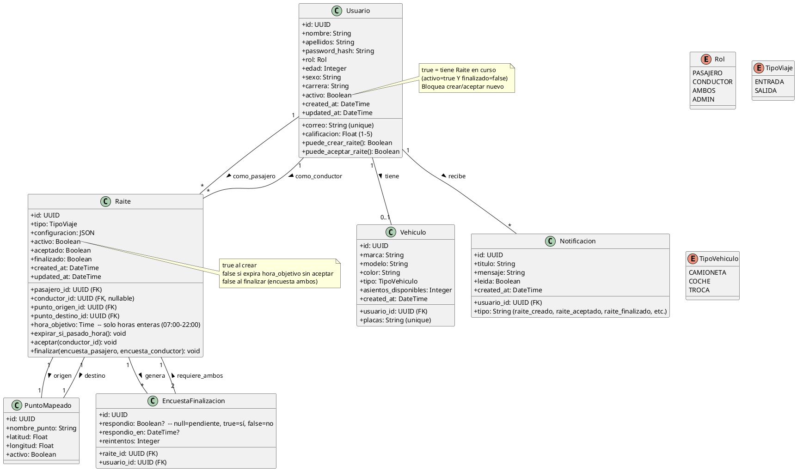
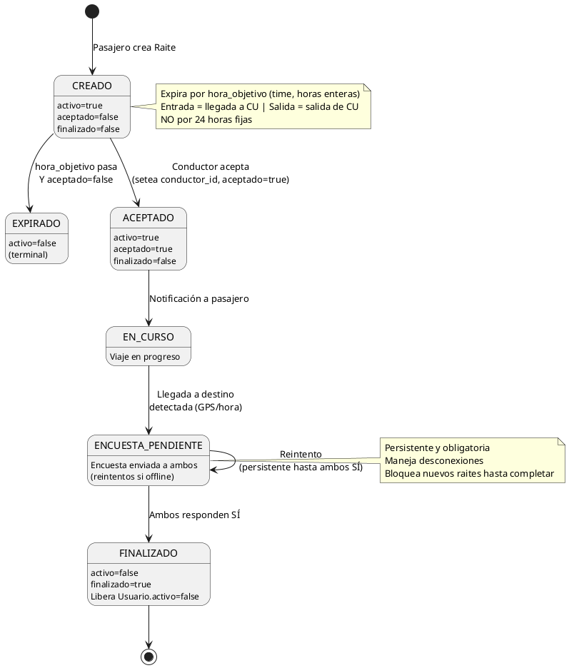
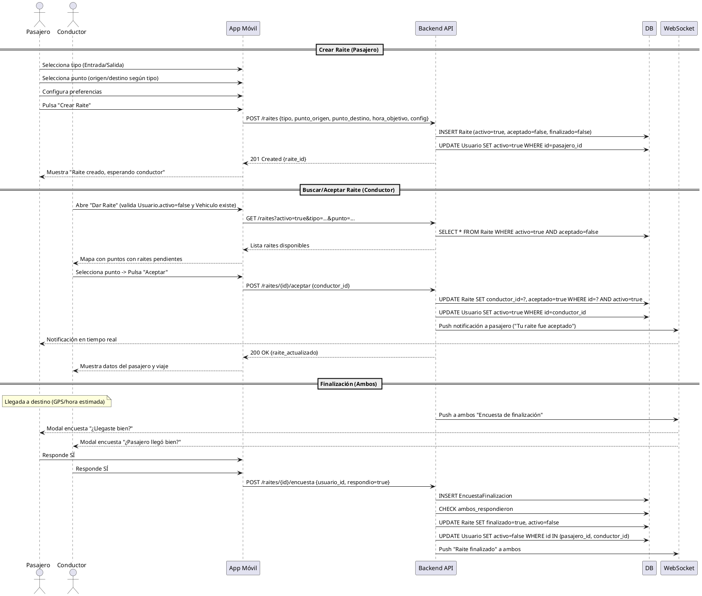
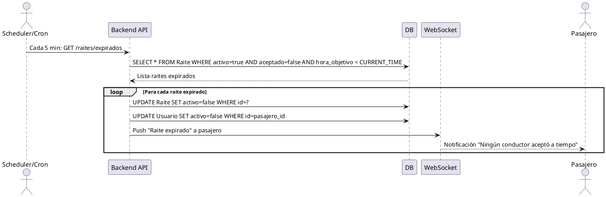

# **Raite - Documento de Layout y Disposición (Mejorado)**

---

## **FLUJOS DE USUARIO**

### **Autenticación**
| Pantalla | Campos | Notas |
|----------|--------|-------|
| **Login** | Correo, Contraseña | Autenticación estándar |
| **Registro - Paso 1** | Nombre completo, Correo, Contraseña, **Rol(es)** | Usuario elige: **Pasajero**, **Conductor**, o **Ambos** |
| **Registro - Paso 2 (Condicional)** | **Datos del Vehículo** | **Solo si elige "Conductor" o "Ambos"** |

> **Campos del Vehículo (Paso 2):**
> - Marca
> - Modelo
> - Color
> - Placas
> - Tipo de vehículo: `Camioneta` / `Coche` / `Troca`
> - Número de asientos disponibles para pasajeros

> **Reglas de negocio:**
> - Los pasajeros solo ven la placa del conductor **después de aceptar** el viaje
> - **Entrada**: Recogida = Punto del sistema (seleccionable), Destino = **CU** (fijo)
> - **Salida**: Recogida = **CU** (fijo), Destino = Punto del sistema (seleccionable)
> - Usuario con ambos roles ve ambas interfaces (Home cambia según rol activo)
> - Perfil de conductor **requiere vehículo válido** para activar modo "Dar Raite"

---

### **PANTALLA HOME**

#### **Panel 1 - Selección de Viaje y Rol Activo**
| Elemento | Tipo | Opciones | Notas |
|----------|------|----------|-------|
| Tipo de viaje | Radio/Select | `Entrada` (a la escuela) / `Salida` (de la escuela) | Requerido |
| **Rol activo** | Toggle / Segmented Control | `Pasajero` / `Conductor` | **Solo si usuario tiene ambos roles**; si solo tiene uno, se oculta y usa ese rol |

---

#### **Panel 2 - Tarjetas de Estado Dinámico**

| Estado | Disparador | Datos mostrados |
|--------|------------|-----------------|
| **🟢 "¡Hola! Solicita un raite"** | Pasajero sin solicitud activa | Estado vacío con CTA a "Pedir Raite" |
| **🔵 "¡Han solicitado ser tu raite!"** | Conductor recibe solicitud | **Datos del Conductor** + **Datos del Viaje** (ver abajo) |
| **🟡 "¡Han aceptado tu raite!"** | Solicitud del pasajero aceptada | **Datos del Pasajero** + **Datos del Viaje** |
| **🟣 "¡Tienes un raite programado!"** | Viaje confirmado (ambas partes) | **Datos del Contraparte** + **Datos del Viaje** |

---

#### **Estructuras de Datos**

**Perfil de Conductor:**
- Nombre, Edad, Sexo, Carrera
- Calificación (★ 1-5)
- **Vehículo:**
  - Marca, Modelo, Color, Placas
  - Tipo: `Camioneta` / `Coche` / `Troca`
  - Asientos disponibles para pasajeros
- Preferencias de viaje
- **`activo` (bool):** `true` si tiene un Raite en curso (aceptado y no finalizado)

**Perfil de Pasajero:**
- Nombre, Edad, Sexo, Carrera
- Calificación (★ 1-5)
- Preferencias de viaje
- **`activo` (bool):** `true` si tiene un Raite en curso (creado/aceptado y no finalizado)

**Raite:**
- `pasajero_id` (FK)
- `conductor_id` (FK, nullable hasta aceptación)
- `tipo`: `Entrada` / `Salida`
- **Entrada**: `punto_recogida` (sistema) → `punto_destino` = **CU** (fijo)
- **Salida**: `punto_recogida` = **CU** (fijo) → `punto_destino` (sistema)
- `hora_objetivo` (time, solo horas enteras: 07:00–22:00)
  - **Entrada**: hora de **llegada a CU** (deadline)
  - **Salida**: hora de **salida de CU** (cuándo parten)
- `configuracion`: mismo sexo, usar cajuela, mascotas, etc.
- **Estados (bool):**
  - `activo`: `true` al crear, `false` si expira por hora o se finaliza
  - `aceptado`: `false` inicial, `true` cuando conductor acepta
  - `finalizado`: `false` inicial, `true` tras encuesta **ambos**
- `created_at`, `updated_at`

> **Regla de expiración (Entrada):** Si `hora_objetivo` (llegada a CU) pasa y `aceptado=false` → `activo=false`
> 
> **Regla de expiración (Salida):** Si `hora_objetivo` (salida de CU) pasa y `aceptado=false` → `activo=false`
>
> **Finalización obligatoria:** Encuesta persistente (reintenta si offline). Ambos deben responder `sí` → `finalizado=true`, `activo=false`, libera `activo` en ambos perfiles.
>
> *Placas visibles solo tras `aceptado=true`*

---

### **PEDIR RAITE (Pasajero) — Crea un RAITE**

| Paso | Componente | Descripción |
|------|------------|-------------|
| 1 | **Vista de Mapa** (panel derecho) | **Entrada**: Seleccionar punto de **recogida** del sistema **Salida**: Seleccionar punto de **destino** del sistema (recogida fija en CU) |
| 2 | **Botón "Dar Raite"** | Crea el **Raite** con: `hora_objetivo` (time, horas enteras), `tipo`, `punto_origen`, `punto_destino`, `configuracion` **Atributos del Raite:** `aceptado` (bool), `finalizado` (bool), `activo` (bool) |
| 3 | **Panel de Detalle del Punto** (panel izquierdo) | Muestra info del punto, conductores cercanos, ETA |

> **Ciclo de vida del Raite:**
> - `activo=true` al crearse
> - **Entrada**: Si nadie acepta antes de `hora_objetivo` (llegada a CU) → `activo=false`
> - **Salida**: Si nadie acepta antes de `hora_objetivo` (salida de CU) → `activo=false`
> - Si conductor acepta → `aceptado=true`, se notifica a pasajero
> - **Finalización:** Ambos (pasajero + conductor) responden encuesta obligatoria y persistente → `finalizado=true`
> - **Bloqueo:** Usuario con `activo=true` en cualquier Raite **no puede** crear/aceptar otro (maneja desconexiones)

---

### **DAR RAITE (Conductor)**

| Paso | Componente | Descripción |
|------|------------|-------------|
| 1 | **Vista de Mapa** (panel derecho) | **Entrada**: Puntos con raites de **recogida** activos **Salida**: Puntos con raites de **destino** activos (recogida en CU) |
| 2 | **Botón Aceptar** | Setea `aceptado=true` en el Raite, notifica al pasajero, vincula conductor al Raite |

> **Validación previa:** Conductor debe tener `activo=false` (no tener raite en curso) y vehículo válido

---

## **PANEL DE ADMINISTRACIÓN**

| Sección | Funcionalidades |
|---------|-----------------|
| **Usuarios** | Listar todos / filtrar por rol (Pasajero/Conductor/Admin), búsqueda, paginación |
| **Puntos de Raite** | CRUD + filtrar por zona, demanda, estado |
| **Raites Pedidos** | Filtrar por fecha, estado, usuario, punto |
| **Raites Programados** | Igual que anterior + distinción por atributo `status=confirmado` |
| **Vehículos** | CRUD + filtrar por tipo, capacidad, conductor |

---

## **NOTAS TÉCNICAS / PENDIENTES**

- [ ] **Integración Leaflet**: ¿Cómo se almacenan los Puntos? ¿POIs pre-mapeados (centros comerciales, tiendas)?
- [ ] **Guardias de Autenticación**: Protección de rutas por rol (Pasajero vs Conductor vs Admin)
- [ ] **Django Admin**: Personalizar admin por defecto para modelos de Raite
- [ ] **Diagrama UML**: Generar desde esta especificación (Clases, Secuencia, Estados)
- [ ] **Tiempo Real**: Estrategia WebSocket para solicitudes/actualizaciones de viajes
- [ ] **Notificaciones**: Push + in-app para cambios de estado de viaje

---

## **MEJORAS UI/UX (Sugeridas)**

1. **Skeleton Loaders** para mapa y paneles de datos
2. **Estados Vacíos** con ilustraciones para cada estado del panel
3. **Notificaciones Toast** para actualizaciones de viaje (solicitado, aceptado, cancelado)
4. **Bottom Sheet** para detalles de viaje en móvil (en lugar de panel lateral)
5. **Seguimiento ETA Conductor** en vivo en pantalla "Tienes un raite programado"
6. **Modal de Calificación** post-viaje (ambas partes)

---

*Generado desde `Raite_layout_disposition.md` — Original conservado*

---

## **DIAGRAMAS UML**

### **1. Diagrama de Clases**

---

### **2. Diagrama de Estados del Raite**

---

### **3. Diagrama de Secuencia: Crear y Aceptar Raite**

---

### **4. Diagrama de Secuencia: Expiración por Tiempo**

---

*Documento completo con UML generado. Original en `Raite_layout_disposition.md` conservado.*