# **Raite - Documento de Layout y Disposición (Mejorado)**

---

## **FLUJOS DE USUARIO**

### **Autenticación**
| Pantalla | Campos | Notas |
|----------|--------|-------|
| **Login** | Correo, Contraseña | Autenticación estándar |
| **Registro - Paso 1** | Nombre completo, Correo, Contraseña, **Rol** | Usuario elige: **Pasajero** o **Conductor** (rol único) |
| **Registro - Paso 2 (Condicional)** | **Datos del Vehículo** | **Solo si eligió rol `CONDUCTOR`** |

> **Campos del Vehículo (Paso 2):**
> - Marca
> - Modelo
> - Color
> - Placas
> - Tipo de vehículo: `Camioneta` / `Coche` / `Troca`
> - Número de asientos disponibles para pasajeros
> - `activo` (bool, por defecto `true`): lo controla el Admin. `activo=false` → `es_valido_para_conducir()` = `false` y el modo "Dar Raite" queda bloqueado

> **Flujo de estados del Raite:**
> ```text
> CREADO ──conductor toma──▶ PROPUESTO ──pasajero acepta──▶ CONFIRMADO ──comienza el viaje──▶ EN_CURSO
>    ▲                          │
>    │                          └──pasajero rechaza──▶ CREADO (rechazado=true; queda el intento en RaiteIntento)
>    │
>    └──expira hora_objetivo──▶ EXPIRADO
> ```
>
> **Flujo de interacción (4 pasos, obligatorio y sin saltos):**
> 1. **Pasajero pide** un raite en un punto mapeado de la BD → `CREADO` (`activo=true, aceptado=false, confirmado=false, rechazado=false`)
> 2. **Conductor elige** uno de los raites que el mapa le muestra y lo **toma** (`Raite.aceptar()`): `aceptado=true` → `PROPUESTO`, se registra un `RaiteIntento` en `PENDIENTE` y **se notifica al pasajero**
> 3. **Pasajero responde**: `Raite.responder(acepta=True|False)`. Si acepta → `confirmado=true` (`CONFIRMADO`); si rechaza → `rechazado=true` y el raite **vuelve a `CREADO`** para otro conductor
> 4. **Notificación al conductor**: al aceptar el pasajero se le notifica; al rechazar también se le notifica que el raite se liberó
>
> **Reglas de negocio:**
> - **`aceptado=true` = un CONDUCTOR tomó/aceptó la solicitud de Raite** y el Raite está en `PROPUESTO`. **No significa que el viaje esté acordado**: el acuerdo cerrado solo existe cuando `confirmado=true`, es decir, cuando el PASAJERO aceptó a ese conductor
> - **`rechazado` NO es un estado del Raite:** es una marca de que el último intento/propuesta fue rechazado por el pasajero. El estado de negocio tras el rechazo vuelve a ser `CREADO`, con `rechazado=true` como evidencia de que hubo un rechazo
> - **`CREADO` representa dos situaciones indistinguibles por estado:** un Raite recién creado (`rechazado=false`) o un Raite devuelto al mapa tras un rechazo (`rechazado=true`)
> - **Mientras el raite está `PROPUESTO` ni el pasajero ni el conductor pueden tomar otro raite** (`cuenta_activa=1` en ambos). La decisión del pasajero es obligatoria: sin ella el raite expira
> - **Un raite rechazado vuelve a estar disponible** (`activo=true, aceptado=false, rechazado=true, conductor_id=null`) y reaparece en el mapa del conductor; el conductor que lo tomó queda libre (`cuenta_activa=0`)
> - **El mismo conductor no puede volver a tomar un raite que ya le rechazó el pasajero** mientras el raite siga en la misma sesión activa. La garantía no puede apoyarse en `Raite.conductor_id` (que se limpia al rechazar), sino en el historial: `RaiteIntento` con `resultado = RECHAZADO` para ese `(raite_id, conductor_id)`
> - **Límite de rechazos:** `MAX_RECHAZOS_POR_RAITE = 3`, sujeto a **configuración de negocio**. El conteo es derivado del historial, no un contador almacenado: `cantidad_rechazos = COUNT(RaiteIntento) WHERE raite_id = X AND resultado = RECHAZADO`
> - **El rastreo GPS NO comienza con `aceptado=true`.** Comienza cuando el Raite está `CONFIRMADO` **y** pasa a `EN_CURSO` (`en_curso=true`), que es el momento en que se habilita `GestorUbicacionLive`
> - **`CONFIRMADO → EN_CURSO` exige un disparador explícito:** acción del conductor + verificación GPS (`≤ DISTANCIA_INICIO_VIAJE` del punto de recogida). Sin GPS disponible, el pulso basta y el viaje se marca `sin_gps`. Si nadie lo activa en `GRACIA_INICIO_VIAJE` tras la hora de encuentro, el sistema lo activa y notifica a ambos
> - Los pasajeros solo ven la placa del conductor **después de confirmar** el viaje (en `PROPUESTO` el pasajero ve nombre, calificación y tipo de vehículo para decidir, no las placas)
> - **El pasajero solo puede pedir raite en puntos del catálogo** (ver Catálogo de Puntos de Raite). No se admiten coordenadas libres
> - **El conductor solo ve los puntos con raites activos**: el mapa nunca muestra el catálogo completo, solo los puntos donde hay alguien esperando
> - **Entrada**: Recogida = Punto del catálogo (seleccionable), Destino = **CU** (fijo)
> - **Salida**: Recogida = **CU** (fijo), Destino = Punto del catálogo (seleccionable)
> - Usuario con rol PASAJERO ve interfaz de pasajero; usuario con rol CONDUCTOR ve interfaz de conductor
> - **El rol `ADMIN` no está disponible en el registro público.** Solo un Admin existente lo otorga
> - **El rol `ADMIN` es independiente y NO implica `PASAJERO` ni `CONDUCTOR`.** Asignar `ADMIN` no cambia el rol del usuario (un usuario tiene un solo rol). El perfil administrativo **está exento de poseer `Vehiculo`** y la interfaz de Administración no le exige datos de vehículo
> - **Si un administrador quiere operar en la plataforma** (pedir raite como pasajero o dar raite como conductor), debe **cambiar su rol por separado** y, en el caso de `CONDUCTOR`, **completar el Paso 2 de registro (datos del vehículo)**. `ADMIN + PASAJERO` y `ADMIN + CONDUCTOR` son combinaciones válidas, pero **opt-in**, nunca automáticas
> - **`sexo` es obligatorio y sin opción "prefiere no decir".** Por seguridad de los estudiantes no se permite la opción de no verificar el sexo biológico. El catálogo de `Sexo` no debe incluir `PREFIERE_NO_DECIR` ni valores vacíos
> - **Suspensión por reincidencia:** `Usuario.suspendido=true` cuando el usuario acumula **`MAX_TICKETS_SUSPENSION = 3` tickets resueltos** en su contra (`TicketRevision.implicado_id`). Mientras está suspendido **no puede crear ni tomar raites**; el login sigue permitido para que vea el aviso y sus viajes históricos. El Admin puede levantar la suspensión. La regla es **simétrica** para pasajero y conductor
> - **`is_superuser` / `is_staff` son exclusivos del rol `ADMIN`.** Ninguna cuenta que sea **solo** `PASAJERO`, **solo** `CONDUCTOR` puede tenerlos en `true`; ambas banderas deben permanecer en `false`. El acceso al Panel de Administración y al Django Admin se concede únicamente vía `is_staff`/`is_superuser`, y quien las tenga `true` debe tener `rol=ADMIN`
> - Perfil de conductor **requiere vehículo válido** (`Vehiculo.es_valido_para_conducir()`) para activar modo "Dar Raite"
> - **`Usuario.activo` y `Usuario.cuenta_activa` son caché, no fuente de verdad.** `Usuario.activo` significa **"el usuario está ocupado en un Raite activo"**, NO "la cuenta está habilitada". La verdad es el estado de los Raites del usuario (`activo/aceptado/confirmado/en_curso/en_revision/rechazado/finalizado`); **única** estrategia de sincronización: `Raite.sincronizar_cuenta_activa()`, llamada dentro de la misma transacción de cada transición
> - Nunca editar `activo`/`cuenta_activa` desde la API: se hace dentro de la transacción de la transición que los dispara

---

### **CATÁLOGO DE PUNTOS DE RAITE**

Los puntos **no son coordenadas libres**: es un **catálogo cerrado** de comercios de la ciudad, cargado por el Admin. El pasajero **elige de este catálogo**; el sistema no permite marcar un punto arbitrario en el mapa.

| `nombre_punto` | Tipo | Sucursales | Notas |
|----------------|------|------------|-------|
| **Walmart** | Supermercado | Varias | |
| **S-Mart** | Supermercado | Varias | |
| **Sam's** | Supermercado | Varias | Club de socios, revisar acceso |
| **Soriana** | Supermercado | Varias | |
| **Oxxo** | Tienda de conveniencia | Varias | |
| **Aurrerá** | Supermercado | Varias | |
| **Superette** | Supermercado | Varias | |
| **Del Río** | Supermercado | Varias | |
| **Extra** | Hipermercado | Varias | |
| **Circle K** | Tienda de conveniencia | Varias | |

> **Reglas del catálogo:**
> - **Cada sucursal es una fila** en `PuntoMapeado`. Como el modelo solo tiene `nombre_punto` + `latitud`/`longitud`, dos sucursales de la misma cadena **deben** diferenciarse en el nombre: `Soriana - Centro`, `Soriana - Norte`. Sin eso se colisionan
> - **`nombre_punto` es único junto a `activo`:** la restricción es `UNIQUE(nombre_punto, activo)`. Consecuencias:
>   - Solo puede existir **un punto activo** con un mismo `nombre_punto`
>   - **Sí** se permite un punto **inactivo** con el mismo nombre (p. ej. `Soriana - Centro` activo y `Soriana - Centro` inactivo): es intencional para conservar el histórico de raites ya asociados sin exponerlo en los mapas
>   - Si un punto inactivo debe volver a operar, se **reactiva el registro existente** (`activo=true`); nunca se crea un duplicado con el mismo nombre mientras exista uno activo
> - El `nombre_punto` visible se muestra normalizado (`Aurrerá`, `Del Río`, `Circle K`) aunque el identificador de carga sea plano (`aurrera`, `del_rio`, `circlek`)
> - `activo=false` saca el punto del mapa del pasajero sin borrar el historial de raites ya asociados
> - El **CU** es un punto del sistema más, fijo, y **no** aparece en el catálogo seleccionable
> - Alta y edición: solo Admin (Panel de Administración → Puntos de Raite). Carga inicial por *seed*/migración

---

### **MAPAS, GEOCODIFICACIÓN Y RASTREO EN VIVO**

Esta sección recoge la implementación técnica de los mapas, la geocodificación del catálogo de puntos y el seguimiento GPS en tiempo real durante los viajes activos.

#### **Poblado de la Base de Datos (Catálogo de Puntos)**

De acuerdo a la arquitectura, los puntos de Raite son estáticos y provienen de un catálogo cerrado. Se utilizará **Overpass Turbo** para la extracción inicial y un script *seed* para llenar la tabla `PuntoMapeado`.

##### **Consulta en Overpass Turbo**
Ve a [overpass-turbo.eu](https://overpass-turbo.eu/) y ejecuta la siguiente consulta. Este ejemplo extrae todos los "Oxxo" en Ciudad Juárez. (Deberás repetir o agrupar la consulta para Walmart, S-Mart, etc.).

```text
[out:json][timeout:25];
// Definir el área de búsqueda (Ciudad Juárez)
area["name"="Ciudad Juárez"]->.searchArea;
(
  // Buscar nodos (puntos simples)
  node["name"~"Oxxo", i](area.searchArea);
  // Buscar vías/polígonos (edificios)
  way["name"~"Oxxo", i](area.searchArea);
);
// 'out center' convierte los polígonos en un solo punto central (lat/lon)
out center;
```

##### **Procesamiento y Seed (Migración)**
Exporta el resultado como **JSON**. El JSON resultante tendrá una estructura con elementos (`elements`). Debes iterar sobre ellos en tu script de backend (ej. Django/Node) para llenar la base de datos.

**Lógica del Seed:**
1. Iterar sobre `elements` del JSON.
2. Si es tipo `node`, usar `lat` y `lon`. Si es tipo `way`, usar `center.lat` y `center.lon`.
3. **Resolución de colisiones:** Como `nombre_punto` debe ser único, debes concatenar la calle o colonia (que a menudo viene en el objeto `tags` de Overpass) para diferenciar sucursales. Ej: `tags.name + " - " + tags['addr:street']` -> *"Oxxo - Avenida Tecnológico"*.
4. Insertar en `PuntoMapeado` con `activo = true`.

---

#### **Uso de Leaflet y Seguimiento Live (GPS)**

El rastreo en vivo se usa únicamente cuando el Raite está `CONFIRMADO` **y** pasa a `EN_CURSO` (`confirmado=true ∧ en_curso=true`), es decir, cuando hay acuerdo cerrado entre pasajero y conductor y el viaje comienza. **No se habilita con `aceptado=true`** (el simple hecho de que un conductor haya tomado el raite no autoriza el rastreo). Se requiere la API de Geolocalización de HTML5 en el frontend y WebSockets para compartir la ubicación.

##### **Renderizado Básico con Leaflet**
Para mostrar el catálogo o los viajes pendientes:

```javascript
// Inicializar mapa centrado en CU / Ciudad Juárez
const map = L.map('mapa').setView([31.6904, -106.4245], 13);
L.tileLayer('https://{s}.tile.openstreetmap.org/{z}/{x}/{y}.png').addTo(map);

// Agregar un punto estático de la BD
const marcadorOxxo = L.marker([latBD, lonBD]).addTo(map);
marcadorOxxo.bindPopup("Oxxo - Tecnológico (2 esperando)");
```

##### **Seguimiento Live GPS del Dispositivo**
Lógica exclusiva para el **Conductor** (para emitir) y el **Pasajero** (para recibir).

```javascript
let marcadorConductor;
let watchId;

// INICIAR RASTREO (Se ejecuta en el celular del Conductor)
function iniciarRastreo(raiteId) {
    if (!navigator.geolocation) return alert("GPS no soportado");

    watchId = navigator.geolocation.watchPosition(
        (position) => {
            const { latitude, longitude } = position.coords;
            
            // 1. Actualizar Leaflet localmente
            if (!marcadorConductor) {
                marcadorConductor = L.marker([latitude, longitude]).addTo(map);
            } else {
                marcadorConductor.setLatLng([latitude, longitude]);
            }
            map.setView([latitude, longitude]); // Centrar mapa

            // 2. Enviar por WebSocket al backend
            socket.send(JSON.stringify({
                tipo: 'ubicacion_conductor',
                raite_id: raiteId,
                lat: latitude,
                lon: longitude
            }));
        },
        (error) => console.error("Error GPS:", error),
        { enableHighAccuracy: true, maximumAge: 0 }
    );
}

// DETENER RASTREO (Al llegar al destino o finalizar)
function detenerRastreo() {
    if (watchId) navigator.geolocation.clearWatch(watchId);
}
```

---

#### **Actualizaciones al Diagrama de Clases UML**

Para soportar el rastreo en vivo sin sobrecargar la base de datos relacional (no debes guardar cada coordenada en SQL por segundo), debes modelar una interfaz de **WebSocket/Caché**.

**Atributos en `Raite`:**
* No agregues `lat/lon` actual a la tabla `Raite` si cambia cada segundo. Usa la base de datos solo para persistir estados.

**Nueva Clase Transitoria (WebSocket Manager / Redis):**
Añade una clase `GestorUbicacionLive` (representa el canal WebSocket/Caché) con estereotipo `<<Transient>>` o `<<Service>>`.

```plantuml
class GestorUbicacionLive <<Service>> {
  + conectar_cliente(usuario_id, raite_id)
  + actualizar_ubicacion(raite_id, conductor_id, latitud, longitud)
  + notificar_pasajero(raite_id, latitud, longitud)
  + desconectar_cliente(usuario_id)
}
```

**Nuevos Métodos en el Frontend (App/UI):**
Si tu UML modela la aplicación cliente, agrega:

```plantuml
class AppMovil {
  + watch_id: Integer
  + iniciar_rastreo_gps(raite_id): void
  + detener_rastreo_gps(): void
  + actualizar_mapa_leaflet(latitud, longitud): void
}
```

**Relaciones a Agregar en el UML:**
* `GestorUbicacionLive` ---> `Raite` : Lee estado (solo habilita el canal si `confirmado=true ∧ en_curso=true`, es decir `EN_CURSO`)
* `AppMovil` ---> `GestorUbicacionLive` : Emite/Escucha eventos por WebSocket
* `AppMovil` ---> `PuntoMapeado` : Renderiza marcadores estáticos en Leaflet

---

### **PANTALLA HOME**

#### **Panel 1 - Selección de Viaje y Rol Activo**
| Elemento | Tipo | Opciones | Notas |
|----------|------|----------|-------|
| Tipo de viaje | Radio/Select | `Entrada` (a la escuela) / `Salida` (de la escuela) | Requerido |
| **Rol activo** | Toggle / Segmented Control | `Pasajero` / `Conductor` | **Solo si usuario tiene ambos roles**; si solo tiene uno, se oculta y usa ese rol |

---

#### **Panel 2 - Tarjetas de Estado Dinámico**

| Estado | Disparador | Datos mostrados |
|--------|------------|-----------------|
| **🟢 "¡Hola! Solicita un raite"** | Pasajero sin solicitud activa | Estado vacío con CTA a "Pedir Raite" |
| **🔵 "¡X te ofrece el raite!"** | **Conductor tomó el raite** (`PROPUESTO`, `aceptado=true, confirmado=false`) — **el pasajero decide** | **Datos del Conductor** (sin placas) + **Datos del Viaje** + temporizador de respuesta + botones **"Aceptar"** / **"Rechazar"** |
| **🟡 "Esperando respuesta del pasajero"** | Solo para el **conductor** que tomó el raite y aún no hay respuesta (`PROPUESTO`) | **Datos del Viaje** + temporizador hasta `hora_objetivo`; el mapa ya no muestra el raite |
| **🟣 "¡El pasajero aceptó tu raite!"** | **Pasajero aceptó** (`confirmado=true`) — se muestra al **conductor** | **Datos del Pasajero** + **Datos del Viaje** + **placas desbloqueadas** |
| **🔴 "Raite rechazado"** | Notificación al **conductor** cuyo propuesta fue rechazada: el raite ya está en `CREADO` con `rechazado=true` | Motivo opcional + CTA "Buscar otro raite"; su `cuenta_activa` vuelve a `0` |
| **⚫ "¡Tienes un raite programado!"** | **Acuerdo cerrado**: `confirmado=true` (ambas partes) | **Datos del Contraparte** (placas incluidas) + **Datos del Viaje** + hora de encuentro |

> **Las tarjetas son distintas por rol:** el pasajero nunca ve "Esperando respuesta" (él es quien responde) y el conductor nunca ve "te ofrecen el raite". Cada estado se deriva de los bools, no de un enum:
> - `CREADO` = `activo ∧ ¬aceptado ∧ ¬confirmado` (`rechazado` indiferente)
> - `PROPUESTO` = `activo ∧ aceptado ∧ ¬confirmado`
> - `CONFIRMADO` = `activo ∧ aceptado ∧ confirmado ∧ ¬en_curso`
> - `EN_CURSO` = `activo ∧ confirmado ∧ en_curso`
> - **No existe un estado `RECHAZADO`**: el rechazo se comunica como **notificación** al conductor (`raite_rechazado`) y como marca `rechazado=true` sobre un Raite que sigue en `CREADO`

---

#### **Estructuras de Datos**

**Suspendición (`Usuario.suspendido`):**
- Booleano independiente del estado de ocupación: `activo` = "ocupado en un raite", `suspendido` = "cuenta penalizada"
- Se activa **automáticamente** al alcanzar `MAX_TICKETS_SUSPENSION = 3` tickets resueltos en contra del usuario, y **manualmente** por el Admin
- Mientras `suspendido=true`: bloquea `crear()` y `aceptar()` (pasajero y conductor por igual); el acceso a la cuenta y al historial se conserva
- **No se borra al liberar raites:** no es caché de `Raite`, es una sanción. Solo la limpia el Admin
- Conteo **derivado** (sin contador almacenado): `tickets_en_contra = COUNT(TicketRevision) WHERE implicado_id = X AND estado = RESUELTO`

**Roles (`Usuario.rol`):**
- Un usuario tiene **UN** rol: `PASAJERO` (2), `CONDUCTOR` (3), `ADMIN` (1)
- Valores enteros: `1=ADMIN`, `2=PASAJERO` (default), `3=CONDUCTOR`
- **"Ambos" no es un valor almacenado**: en la interfaz se muestra "Ambos" si el usuario cambió de rol (opt-in) o tiene historial en ambos, pero en BD es un solo rol actual
- Un `ADMIN` **no** requiere `Vehiculo` (exento por diseño). Un `CONDUCTOR` sí requiere vehículo válido

**Perfil de Conductor:**
- Nombre, Edad, Sexo, Carrera
- Calificación (★ 1-5)
- **Vehículo** (0..1, obligatorio para dar raite):
  - Marca, Modelo, Color, Placas
  - Tipo: `Camioneta` / `Coche` / `Troca`
  - Asientos disponibles para pasajeros
- Preferencias de viaje
- **`activo` (bool, caché):** `true` si el usuario **está ocupado en un Raite activo** (tomado y no finalizado; incluye `PROPUESTO`: propone y espera respuesta del pasajero). **NO significa "la cuenta está habilitada"**: la habilitación de la cuenta es una condición distinta (rol vigente, vehículo válido). Se conserva el nombre `activo` por compatibilidad; su lectura semántica es "tiene Raite activo"
- **`cuenta_activa` (Integer, caché):** nº de Raites activos del usuario. Hoy solo admite `0` (no tiene Raite activo) o `1` (tiene Raite activo); se mantiene `Integer` —y no `Boolean`— por compatibilidad con futuras reglas de ocupación (p. ej. varias plazas como pasajero). No es un `Boolean`

**Perfil de Pasajero:**
- Nombre, Edad, Sexo, Carrera
- Calificación (★ 1-5)
- Preferencias de viaje
- **`activo` (bool, caché):** `true` si el usuario **está ocupado en un Raite activo** (creado/tomado y no finalizado; incluye `PROPUESTO`, esperando su decisión). **NO significa "la cuenta está habilitada"**: el pasajero puede tener la cuenta habilitada y `activo=false` si no tiene ningún raite en curso
- **`cuenta_activa` (Integer, caché):** nº de Raites activos del usuario. Hoy solo admite `0` (no tiene Raite activo) o `1` (tiene Raite activo); se mantiene `Integer` por compatibilidad/futura extensibilidad. No es un `Boolean`

**Raite:**
- `pasajero_id` (FK)
- `conductor_id` (FK): **conductor asociado al Raite en su situación actual**. `null` mientras ningún conductor lo ha tomado; se asigna en `aceptar()`; se limpia al rechazar. **No es historial**: los conductores que participaron antes se conservan en `RaiteIntento`
- `rol_actual`: rol con el que actúa en este viaje (solo si el usuario tiene ambos roles)
- `tipo`: `Entrada` / `Salida`
- **Entrada**: `punto_recogida` (sistema) → `punto_destino` = **CU** (fijo)
- **Salida**: `punto_recogida` = **CU** (fijo) → `punto_destino` (sistema)
- `hora_objetivo` (time, solo horas enteras: 07:00–22:00)
  - **Entrada**: hora de **llegada a CU** (deadline)
  - **Salida**: hora de **salida de CU** (cuándo parten)
- `pasajeros_requeridos`: se valida contra `Vehiculo.asientos_disponibles` al tomar el raite
- `configuracion`: mismo sexo, usar cajuela, mascotas, etc.
- **Estados (bool):**
  - `activo`: `true` al crear, `false` si expira por hora o se finaliza. **Permanece `true` durante `PROPUESTO`, `CONFIRMADO` y `EN_CURSO`**
  - `aceptado`: `false` inicial, **`true` cuando un conductor toma el raite** (va a `PROPUESTO`). Vuelve a `false` si el pasajero lo rechaza
  - `confirmado`: `false` inicial, `true` cuando **el pasajero acepta** al conductor. Es el único indicador de "acuerdo cerrado"
  - `en_curso`: `false` inicial, `true` cuando **comienza físicamente el viaje**. Permite diferenciar un viaje programado (`confirmado=true`, `en_curso=false`) de uno que está ocurriendo. **Regla de disparo `CONFIRMADO → EN_CURSO`:** acción explícita del conductor ("Iniciar viaje") **más** verificación GPS (conductor a ≤ `DISTANCIA_INICIO_VIAJE` — 300 m por defecto — del punto de recogida). Si el GPS no está disponible, el pulso del conductor basta y el viaje se marca `sin_gps=true`. **Respaldo temporal:** si pasan `GRACIA_INICIO_VIAJE` (15 min por defecto) de la hora de encuentro sin que nadie active el inicio, el sistema pone `en_curso=true` y notifica a ambos, para que un raite nunca quede bloqueado
  - `rechazado`: `false` inicial, `true` cuando **el pasajero rechaza** la última propuesta. **No es un estado**, es una marca: el Raite sigue en `CREADO` (`activo=true, aceptado=false, confirmado=false`) y por eso **no forma parte de la definición de `CREADO`**. El detalle de quién fue rechazado y cuándo vive en `RaiteIntento`
  - `en_revision`: `false` inicial, `true` cuando alguna encuesta de finalización llega con `respondio=false`. No es terminal: el Admin puede reabrirla
  - `finalizado`: `false` inicial, `true` tras encuesta **ambos**
- `created_at`, `updated_at`

> **Invariante de combinación:** `confirmado=true` ⇒ `aceptado=true` ∧ `rechazado=false`. Nunca se pueden tener `confirmado` y `rechazado` a la vez. `aceptado=true ∧ rechazado=true` es imposible (el rechazo resetea `aceptado`)
>
> **`rechazado` NO forma parte de la definición de `CREADO`:** el estado inicial es `activo=true ∧ aceptado=false ∧ confirmado=false`, con `rechazado` **indiferente** (`false` en un raite recién creado, `true` en uno devuelto al mapa por un rechazo). Por eso `PROPUESTO --> CREADO` al rechazar es una transición válida: solo cambia `rechazado`, no el conjunto de banderas que define `CREADO`. `rechazado != estado`
>
> **`hora_objetivo` (semántica por tipo):** es la hora objetivo que el Raite debe cumplir, no una hora de expiración arbitraria
> - **`Entrada`**: `hora_objetivo` = **hora objetivo de llegada a CU**
> - **`Salida`**: `hora_objetivo` = **hora objetivo de salida de CU**
>
> **Regla de expiración:** `hora_objetivo < CURRENT_TIME ∧ confirmado=false` → `activo=false`. Aplica **tanto a `CREADO` como a `PROPUESTO`**: si el conductor ya tomó el raite y el pasajero no responde antes de la hora objetivo, el raite expira igual. En `PROPUESTO`, además, el `RaiteIntento` abierto pasa a `resultado = EXPIRADO` con su `fecha_respuesta`. Solo la expiración **no** depende de que el conductor haya tomado o no el raite
>
> **Toda transición pasa por `sincronizar_cuenta_activa()`:** las **6 operaciones de dominio** son `crear`, `aceptar` (tomar), `responder`, `expirar_si_pasado_hora`, `finalizar` y `marcar_en_revision`. Todas recalculan `Usuario.activo`/`Usuario.cuenta_activa` dentro de la **misma transacción**. Si esa llamada falla, la transición entera revierte: no puede quedar un Raite activo con un usuario libre, ni al revés
>
> **Única fuente de verdad de la ocupación:** el estado de ocupación de un usuario **se deriva del estado de sus Raites activos**, y las transiciones del Raite sincronizan la información de `Usuario` dentro de la misma transacción. No existe ningún otro mecanismo: `Usuario` no expone ninguna operación que escriba su propio estado de ocupación por iniciativa propia
>
> **Finalización obligatoria:** Encuesta persistente (reintenta si offline). Ambos deben responder `sí` → `finalizado=true`, `activo=false`, libera `activo` y `cuenta_activa` en ambos perfiles vía `sincronizar_cuenta_activa()`.
>
> **Ticket de revisión (SLA y suspensión):** cada `TicketRevision` abierto tiene un SLA de **24 horas** para que el Admin lo atienda. Vencido el SLA, el ticket queda `VENCIDO` (visible en el Panel como vencido, sin resolver) y el usuario implicado recibe el aviso correspondiente. Alcanzar **3 tickets resueltos** (`MAX_TICKETS_SUSPENSION`, en contra del usuario) suspende la cuenta
>
> **Contingencia de encuesta (`respondio=false`):** si cualquiera responde `no` (no llegó bien), **no** hay finalización: se ejecuta `sincronizar_cuenta_activa()` (libera a ambos usuarios), se marca `en_revision=true, activo=false` y se abre un `TicketRevision` visible en el Panel de Administración. Ver **EN_REVISION** en el diagrama de estados
>
> *Placas visibles solo tras `confirmado=true`*

**RaiteIntento (historial de intentos de asignación de conductor):**

Registra **cada vez que un conductor toma un Raite** y qué pasó con esa propuesta. Es la fuente de verdad para el historial: `Raite.conductor_id` solo describe la situación actual.

- `id`
- `raite_id` (FK → `Raite`)
- `conductor_id` (FK → `Usuario`): el conductor que tomó el Raite en este intento
- `fecha_toma`: momento en que el conductor tomó el Raite (`aceptar()`)
- `fecha_respuesta`: momento en que el pasajero respondió, o en que expiró la propuesta (`null` mientras `PENDIENTE`)
- `resultado`: catálogo — `PENDIENTE` | `ACEPTADO` | `RECHAZADO` | `EXPIRADO`

> **Relaciones:** `Raite 1 ---- 0..* RaiteIntento` (un raite puede tener varios intentos, uno por conductor que lo tomó) y `Usuario 1 ---- 0..* RaiteIntento` (un conductor acumula un intento por cada raite que tomó)
>
> **Restricciones:** `UNIQUE(raite_id, conductor_id)` con `resultado = PENDIENTE` como máximo uno a la vez (un conductor no puede tener dos propuestas abiertas sobre el mismo raite, porque `aceptar()` es exclusivo)
>
> **Regla de negocio (conductor rechazado):** un conductor **no puede volver a tomar** el mismo Raite si ya existe un `RaiteIntento` de ese conductor para ese Raite con `resultado = RECHAZADO`, mientras el Raite pertenezca a la misma sesión activa. La comprobación es `NOT EXISTS (SELECT 1 FROM RaiteIntento WHERE raite_id = ? AND conductor_id = ? AND resultado = 'RECHAZADO')` dentro de `aceptar()`, por eso el historial **no puede eliminarse**: es lo que hace verificable la regla
>
> **Conteo de rechazos (derivado, sin contador redundado en `Raite`):** `cantidad_rechazos = COUNT(RaiteIntento) WHERE raite_id = X AND resultado = RECHAZADO`. El límite es de negocio, no del modelo: **`MAX_RECHAZOS_POR_RAITE = 3`, sujeto a configuración de negocio**. No hay política adicional más allá de ese límite: superado, el raite deja de reaparecer en el mapa de conductores y se escala a revisión del Admin
>
> **Historial vs. estado actual:** lo que el Raite es *ahora* se lee en `Raite` (`activo`, `aceptado`, `confirmado`, `en_curso`, `rechazado`, `en_revision`, `finalizado`, `conductor_id`); lo que *pasó* (qué conductor lo tomó, cuándo, si fue rechazado, cuándo respondió y en qué terminó) se lee en `RaiteIntento`. `Raite.conductor_id` no sustituye al historial


---

### **PEDIR RAITE (Pasajero) — Crea un RAITE**

| Paso | Componente | Descripción |
|------|------------|-------------|
| 1 | **Vista de Mapa** (panel derecho) | Mapa con los **puntos del catálogo** (Walmart, S-Mart, Sam's, Soriana, Oxxo, Aurrerá, Superette, Del Río, Extra, Circle K) como marcadores seleccionables. Solo se muestran los que tienen `activo=true`<br>**Entrada**: el punto elegido es el de **recogida**<br>**Salida**: el punto elegido es el de **destino** (recogida fija en CU) |
| 2 | **Botón "Dar Raite"** | Invoca `Raite.crear()` con: `rol_actual` (si el usuario tiene ambos roles), `hora_objetivo` (time, horas enteras), `tipo`, `punto_origen`, `punto_destino`, `pasajeros_requeridos`, `configuracion`<br>**Validaciones:** `validar_puntos()` (CU fijo según `tipo` + ambos extremos en el catálogo) + `validar_hora_objetivo()` (07:00–22:00)<br>**Atributos del Raite:** `activo` (bool), `aceptado` (bool), `confirmado` (bool), `en_curso` (bool), `rechazado` (bool), `en_revision` (bool), `finalizado` (bool) |
| 3 | **Panel de Detalle del Punto** (panel izquierdo) | Nombre del comercio y sucursal, coordenadas, conductores cercanos, ETA |

> **Ciclo de vida del Raite:**
> - `activo=true` al crearse (y `sincronizar_cuenta_activa()` marca al pasajero)
> - **Entrada**: Si nadie toma el raite antes de `hora_objetivo` (llegada a CU) → `activo=false`
> - **Salida**: Si nadie toma el raite antes de `hora_objetivo` (salida de CU) → `activo=false`
> - Si un conductor **toma** el raite → `aceptado=true`, `PROPUESTO`, se abre un `RaiteIntento` (`PENDIENTE`) y **se notifica al pasajero** (que ahora debe responder)
> - Si el pasajero **acepta** al conductor → `confirmado=true`, el `RaiteIntento` pasa a `ACEPTADO`, **se notifica al conductor** y el raite queda programado (aún sin rastreo GPS: el GPS espera a `EN_CURSO`)
> - Si el pasajero **rechaza** → `rechazado=true`, `aceptado=false`, `conductor_id=null`, el `RaiteIntento` pasa a `RECHAZADO` (queda el conductor en el historial), **se notifica al conductor** (`raite_rechazado`), se libera su `cuenta_activa` vía `sincronizar_cuenta_activa()` y el raite **reaparece en el mapa** para otro conductor (vuelve a `CREADO` con `rechazado=true`, marca que no forma parte de la definición de ese estado)
> - **Finalización:** Ambos (pasajero + conductor) responden encuesta obligatoria y persistente → `finalizado=true`. Si alguno responde `respondio=false` → `EN_REVISION`: se ejecuta `sincronizar_cuenta_activa()` (libera a ambos) y se abre un ticket visible en el Panel de Administración
> - **Sincronía:** las **6 operaciones de dominio** (`crear`, `aceptar`, `responder`, `expirar_si_pasado_hora`, `finalizar`, `marcar_en_revision`) escriben `activo`/`cuenta_activa` **solo** vía `sincronizar_cuenta_activa()`
> - **Bloqueo:** `no_tiene_raite_en_curso()` debe ser `true` para **crear** y para **tomar** un raite (invariante `cuenta_activa <= 1`). **NO aplica a `responder()`**: el pasajero ya está bloqueado por su propio raite en curso, así que exigir `cuenta_activa == 0` ahí sería una contradicción (el raite le ocupa el cupo). **Ojo con concurrencia:** un `if` no basta, dos peticiones simultáneas pueden pasar el filtro a la vez. Requiere índice único parcial o lock pesimista sobre `Usuario`
> - **`rol_actual` es inmutable** una vez creado el Raite: define contra qué rol se valida la encuesta y qué interfaz ve cada parte

---

### **DAR RAITE (Conductor) — Toma un Raite y Propone**

| Paso | Componente | Descripción |
|------|------------|-------------|
| 1 | **Vista de Mapa** (panel derecho) | **Solo los puntos con raites activos.** El conductor nunca ve el catálogo completo: el mapa se construye desde los raites pendientes, no desde el catálogo<br>**Entrada**: marcadores en los puntos de **recogida** con raites activos<br>**Salida**: marcadores en los puntos de **destino** con raites activos (recogida en CU)<br>Cada marcador muestra **nombre del comercio**, nº de raites esperando y `hora_objetivo` más próxima |
| 2 | **Botón "Tomar Raite"** (antes "Aceptar") | Invoca `Raite.aceptar(conductor_id)`: `validar_vehiculo()`, valida **que no exista un `RaiteIntento` previo de ese conductor con `resultado = RECHAZADO`**, setea `aceptado=true`, vincula conductor, **abre un `RaiteIntento` (`PENDIENTE`)**, crea la notificación `raite_propuesto` al pasajero y sincroniza `cuenta_activa` |
| 3 | **Pantalla "Esperando respuesta"** | El conductor queda bloqueado (`cuenta_activa=1`) con un temporizador hasta `hora_objetivo`. Recibe un push con uno de dos resultados: **el pasajero aceptó** o **el pasajero rechazó** |

> **El conductor no ve al pasajero como "viaje confirmado" al tomar el raite:** acaba de *proponer*, la decisión es del pasajero. El conductor sí ve desde ya el `hora_objetivo`, el punto y los requisitos del viaje (los necesita para calcular su ruta), pero **las placas y el dato de contacto se desbloquean tras `confirmado=true`**

> **Mapa del conductor (`GET /dar-raite/mapa?tipo=...`):**
> Devuelve **únicamente** los `PuntoMapeado` con al menos un `Raite` `activo=true` y `aceptado=false` (es decir, `CREADO`, incluidos los que el pasajero rechazó y volvieron al mapa), agrupados por punto, con el número de raites esperando y la `hora_objetivo` más próxima. **Nunca consulta el catálogo completo**: un punto sin raites no aparece en el mapa, aunque esté activo en el catálogo. El mapa del conductor es un subconjunto del del pasajero
>
> **Filtro por historial:** la consulta de un raite para un conductor debe excluir los raites que ese conductor ya tuvo rechazados en la misma sesión (`NOT EXISTS` sobre `RaiteIntento` con `resultado = RECHAZADO`)

> **Validación previa (`puede_aceptar_raite()`):**
> - `no_tiene_raite_en_curso()` → `cuenta_activa == 0` (y lock para evitar carrera)
> - Posee `rol = CONDUCTOR` (3)
> - `Vehiculo.es_valido_para_conducir()` → existe, completo y activo
> - `Vehiculo.tiene_capacidad(Raite.pasajeros_requeridos)` → hay asientos libres
> - **No** existe un `RaiteIntento` de ese conductor para ese raite con `resultado = RECHAZADO` (misma sesión activa)
> - `cantidad_rechazos < MAX_RECHAZOS_POR_RAITE` (límite de negocio, configurable)

---

### **RESPONDER AL RAITE (Pasajero) — Aceptar o Rechazar al Conductor**

Esta es la **decisión que cierra el acuerdo**. Sin ella el raite no está confirmado y expira en `hora_objetivo`.

| Paso | Componente | Descripción |
|------|------------|-------------|
| 1 | **Notificación push / in-app** | `Notificacion(tipo='raite_propuesto', raite_id, usuario_id=pasajero_id)`. Texto: *"Un conductor te ofrece el raite de las 07:00"* |
| 2 | **Pantalla "Te neumaron" (decisión)** | Muestra **datos del conductor** para decidir: nombre, calificación (★), tipo de vehículo, modelo/color, **ETA**, `hora_objetivo`, punto de recogida y requisitos del viaje. **Las placas siguen ocultas** hasta que el pasajero acepta |
| 3 | **Botón "Aceptar conductor"** | Invoca `Raite.responder(acepta=True)` → `confirmado=true`, **notifica al conductor** (`raite_confirmado`), desbloquea placas/datos de contacto y el raite queda **programado** |
| 4 | **Botón "Rechazar"** | Invoca `Raite.responder(acepta=False)` → `rechazado=true`, `aceptado=false`, `conductor_id=null`, **notifica al conductor** (`raite_rechazado`), libera su `cuenta_activa` y **devuelve el raite al mapa** para otro conductor |

> **Ventana de decisión:** el pasajero tiene hasta `hora_objetivo` para responder. El temporizador es visible en ambas pantallas ("faltan 12 min para responder"). Si no responde, el scheduler aplica `expirar_si_pasado_hora()` y notifica a **ambos** (`raite_expirado`)
>
> **Idempotencia y carrera:** `responder()` solo es válido en `PROPUESTO` (`aceptado=true ∧ confirmado=false ∧ rechazado=false ∧ finalizado=false`). Solo el `pasajero_id` del raite puede responder. Un segundo toque o una respuesta tardía devuelven `409 Conflict` / `422`, nunca una doble transición
>
> **Rechazos encadenados:** el raite admite varios conductores **secuencialmente**, no simultáneos: mientras está `PROPUESTO` no aparece en el mapa de ningún conductor (`aceptado=true` lo excluye). Solo al rechazar vuelve a ser visible, y en ese momento el conductor rechazado queda **en el historial** (`RaiteIntento.resultado = RECHAZADO`): puede volver a aparecer en el mapa, pero ese conductor ya no puede volver a tomarlo en la misma sesión
>
> **Operación de rechazo (en una sola transacción):**
> 1. El `RaiteIntento` abierto pasa a `resultado = RECHAZADO` con su `fecha_respuesta`
> 2. El `conductor_id` **se conserva dentro del historial** (`RaiteIntento.conductor_id`) y se limpia en `Raite.conductor_id = NULL`
> 3. `Raite.aceptado = false`
> 4. `Raite.rechazado = true`
> 5. El Raite **regresa a `CREADO`**
> 6. `sincronizar_cuenta_activa()` **libera al conductor** (`cuenta_activa = 0`); el pasajero sigue ocupado por su propio raite
> 7. El Raite vuelve a estar disponible para otros conductores
> 8. Notificación `raite_rechazado` al conductor (y `raite_reasignado` a los conductores elegibles del punto)
>
> **Límite de rechazos:** `MAX_RECHAZOS_POR_RAITE = 3`, sujeto a **configuración de negocio** (no es una consecuencia del modelo). El conteo es **derivado del historial**: `cantidad_rechazos = COUNT(RaiteIntento) WHERE raite_id = X AND resultado = RECHAZADO`; no se almacena un contador en `Raite`. Superado el límite, el raite deja de reaparecer en el mapa de conductores y se escala a revisión del Admin

> **Endpoints (RTM):**
> - `POST /raites/{id}/aceptar` — **conductor**, cuerpo `{conductor_id}` → toma el raite y notifica (`raite_propuesto`)
> - `POST /raites/{id}/responder` — **pasajero**, cuerpo `{acepta: true|false}` → confirma (`raite_confirmado`) o libera (`raite_rechazado`)
> - `GET /raites/{id}/propuesta` — **pasajero**, devuelve los datos del conductor necesarias para decidir (sin placas si `confirmado=false`)

---

## **PANEL DE ADMINISTRACIÓN**

| Sección | Funcionalidades |
|---------|-----------------|
| **Usuarios** | Listar todos / filtrar por rol (`Usuario.rol`: 1=Admin, 2=Pasajero, 3=Conductor), búsqueda, paginación. Acciones: **Suspender** (`Usuario.suspendido=true`) y **Levantar suspensión**; columna con `tickets_en_contra` derivado |
| **Puntos de Raite** | CRUD del catálogo + filtrar por cadena, zona, `activo`. Alta por sucursal, no solo por cadena |
| **Raites Pedidos** | Filtrar por fecha, estado, usuario, punto |
| **Raites Programados** | Igual que anterior + `confirmado=true` (no hay campo `status`: el estado son los bools `activo`/`aceptado`/`confirmado`/`rechazado`/`finalizado`) |
| **Raites Rechazados** | Filtrar por `rechazado=true`. **No es un estado del Raite**: son raites en `CREADO` cuya última propuesta fue rechazada. Para saber **quién** lo tomó y **cuándo** hay que leer `RaiteIntento` (`resultado = RECHAZADO`), porque `Raite.conductor_id` ya fue limpiado. Sirve para auditar rechazos y detectar conductores abusivos |
| **Tickets vencidos** | `TicketRevision` cuyo SLA de 24 h se agotó sin atención: se listan como `VENCIDO` para que el Admin los atienda |
| **Intentos de Conductor** | Historial `RaiteIntento`: qué conductor tomó cada raite, `fecha_toma`, `fecha_respuesta` y `resultado` (`PENDIENTE`/`ACEPTADO`/`RECHAZADO`/`EXPIRADO`). Filtros por conductor, resultado y raite; cálculo de `cantidad_rechazos` y detección de conductores que acumulan rechazos |
| **Raites en Revisión** | Bandeja de `TicketRevision` (de `en_revision=true`): ver reporte, implicado y motivo; **Resolver** (marcar `RESUELTO` con notas), **Reabrir encuesta** o **Archivar**. Solo `ADMIN` accede. El pasajero y el conductor reciben una notificación de que su reporte está en revisión, pero no tienen acceso a la vista del ticket, al historial de resoluciones ni a las notas internas del Admin |
| **Vehículos** | CRUD + filtrar por tipo, capacidad, conductor + **activar/desactivar** (`Vehiculo.activo`); un vehículo `activo=false` es inválido y no habilita el modo "Dar Raite" |

---

## **NOTAS TÉCNICAS / PENDIENTES**

- [x] **Integración Leaflet**: Los puntos son **POIs pre-mapeados** de un catálogo cerrado (10 cadenas), no coordenadas libres. Solo el Admin los da de alta. Ver **MAPAS, GEOCODIFICACIÓN Y RASTREO EN VIVO**
- [ ] **Cargar catálogo de sucursales**: *seed* de `PuntoMapeado` con `latitud`/`longitud` reales de cada sucursal. **Procedimiento definido** (extracción con Overpass Turbo + script de seed), **pendiente de ejecutar** sobre las 10 cadenas y sus sucursales en Ciudad Juárez
- [x] **Distinguir sucursales**: `nombre_punto` compuesto (`Soriana - Centro`) built desde `tags.name + tags['addr:street']` de Overpass, para evitar colisiones; queda pendiente un identificador de sucursal propio si se requiere
- [ ] **Guardias de Autenticación**: Protección de rutas por rol — la fuente es `Usuario.rol` (campo entero), no una tabla separada. Un admin pasa si `rol=1`; pasajero si `rol=2`; conductor si `rol=3`
- [ ] **Django Admin**: Personalizar admin por defecto para modelos de Raite
- [x] **Diagrama UML**: Generado desde esta especificación (Clases, Estados, Secuencia crear/tomar/responder, Secuencia expiración). Incluye `GestorUbicacionLive` y `AppMovil` para el rastreo GPS
- [ ] **Sincronía de flags**: `Usuario.activo`/`cuenta_activa` son caché derivada de los Raites activos del usuario. Única estrategia: `Raite.sincronizar_cuenta_activa()` dentro de la misma transacción de cada una de las **6 operaciones de dominio** (`crear`, `aceptar`, `responder`, `expirar_si_pasado_hora`, `finalizar`, `marcar_en_revision`); nunca SQL directo ni una operación propia de `Usuario`. Garantizar el **índice único parcial o lock pesimista** que impide dos raites concurrentes con `no_tiene_raite_en_curso()`
- [ ] **Migración de esquema**: añadir `confirmado`, `en_curso`, `rechazado` y `en_revision` a `Raite` (todos `default=false`), y crear `TicketRevision` y `RaiteIntento` (con `resultado` de catálogo e índices por `(raite_id, conductor_id)` y por `(raite_id, resultado)`). Para los raites existentes, `confirmado = aceptado` (backfill: todo lo que se \"aceptó\" antes se considera como confirmado), `rechazado = false`; backfill de `RaiteIntento` con un intento `ACEPTADO` por cada raite que ya tenga `conductor_id`
- [ ] **`RaiteIntento` en todas las escrituras**: abrir el intento en `aceptar()` (`PENDIENTE`) y cerrarlo en `responder()` (`ACEPTADO`/`RECHAZADO`) o en `expirar_si_pasado_hora()` (`EXPIRADO`). Sin historial no se puede garantizar la regla del conductor rechazado ni calcular `cantidad_rechazos`
- [ ] **Tiempo Real**: Estrategia WebSocket para solicitudes/actualizaciones de viajes. El mapa del conductor debe refrescarse al crearse/expirarse **y al rechazar** un raite, no solo al abrir la pantalla. El rastreo GPS ya está modelado con `GestorUbicacionLive` (WebSocket + caché, sin persistir coordenadas en SQL)
- [ ] **Ticket de revisión**: implementar `TicketRevision` (motivo como catálogo `NO_LLEGUE|CANCELADO|MOLESTIA|SEGURIDAD|OTRO`, con `descripcion` obligatoria cuando `motivo = OTRO`) + endpoint `POST /raites/{id}/encuesta` que, con `respondio=false`, ejecute `marcar_en_revision()` dentro de la transacción (nunca SQL directo sobre `Usuario.activo`). El catálogo queda **cerrado para el primer prototipo**: no se agregan valores nuevos sin revisar el modelo
- [ ] **SLA de tickets**: 24 horas desde la apertura. Implementar el marcado `VENCIDO` (por cron) y el aviso al implicado
- [ ] **Suspensión automática**: añadir `Usuario.suspendido` (bool) y el disparador que lo activa al alcanzar `MAX_TICKETS_SUSPENSION = 3` tickets `RESUELTOS` (`COUNT` sobre `TicketRevision`, sin contador almacenado). Aplica a **ambos roles** y solo el Admin puede levantarla
- [ ] **Parámetros de `iniciar_curso()`**: `DISTANCIA_INICIO_VIAJE` (300 m) y `GRACIA_INICIO_VIAJE` (15 min) deben vivir en configuración. El respaldo temporal evita que un raite quede en `CONFIRMADO` para siempre si nadie pulsa "Iniciar viaje"
- [ ] **Flag `sin_gps`**: ya modelado en `Raite`; falta implementarlo. Registra que el viaje arrancó sin verificación por GPS (el conductor denegó permisos o no hay señal), útil para auditar incidencias
- [ ] **Parámetros de negocio**: `MAX_RECHAZOS_POR_RAITE = 3` debe vivir en configuración (no en código ni en el modelo). No hay política adicional definida más allá de ese límite: superado, el raite deja de aparecer en el mapa de conductores y se escala a revisión del Admin
- [ ] **Notificaciones**: Push + in-app para cambios de estado de viaje (`Notificacion` referencia `raite_id` + `usuario_id`). Catálogo de tipos: `raite_creado`, `raite_propuesto` (conductor → pasajero), `raite_confirmado` (pasajero → conductor), `raite_rechazado` (pasajero → conductor), `raite_reasignado` (sistema → conductores elegibles), `raite_expirado`, `raite_finalizado`, `raite_en_revision` (a ambos + Admin), `ticket_resuelto`, `ticket_vencido`, `cuenta_suspendida`

---

## **MEJORAS UI/UX (Sugeridas)**

1. **Skeleton Loaders** para mapa y paneles de datos
2. **Estados Vacíos** con ilustraciones para cada estado del panel
3. **Notificaciones Toast** para actualizaciones de viaje (solicitado, propuesta recibida, aceptada, rechazada)
4. **Bottom Sheet** para detalles de viaje en móvil (en lugar de panel lateral)
5. **Temporizador de decisión** visible en la pantalla "Te neumaron" y en "Esperando respuesta"
6. **Modal de Calificación** post-viaje (ambas partes)

---

*Generado desde `Raite_layout_disposition.md` — Original conservado*

---

## **DIAGRAMAS UML**

### **1. Diagrama de Clases**

```plantuml
@startuml
skinparam classAttributeIconSize 0

enum Rol {
  ADMIN = 1
  PASAJERO = 2
  CONDUCTOR = 3
}

enum TipoViaje {
  ENTRADA
  SALIDA
}

enum TipoVehiculo {
  CAMIONETA
  COCHE
  TROCA
}

enum ResultadoIntento {
  PENDIENTE
  ACEPTADO
  RECHAZADO
  EXPIRADO
}

enum MotivoRevision {
  NO_LLEGUE
  CANCELADO
  MOLESTIA
  SEGURIDAD
  OTRO
}

class Usuario {
  + id: UUID
  + nombre: String
  + apellidos: String
  + correo: String (unique)
  + password_hash: String
  + edad: Integer
  + sexo: String
  + carrera: String
  + calificacion: Float (1-5)
  + rol: Rol  -- 1=ADMIN, 2=PASAJERO, 3=CONDUCTOR (default=2). Un usuario tiene UN solo rol.
  + activo: Boolean  -- CACHÉ: está ocupado en un Raite activo (NO es "cuenta habilitada")
  + cuenta_activa: Integer  -- CACHÉ: nº de Raites activos; hoy 0 o 1 (restricción de negocio), Integer por extensibilidad
  + suspendido: Boolean  -- SANCIÓN: cuenta penalizada (3 tickets resueltos en contra o acción del Admin)
  + is_staff: Boolean  -- exclusivo de rol ADMIN
  + is_superuser: Boolean  -- exclusivo de rol ADMIN
  + is_active: Boolean  -- habilitación de cuenta (login permitido aunque suspendido)
  + last_login: DateTime
  + date_joined: DateTime
  + created_at: DateTime
  + updated_at: DateTime
  + puede_crear_raite(): Boolean
  + puede_aceptar_raite(): Boolean
  + no_tiene_raite_en_curso(): Boolean
  + tiene_rol(rol: Rol): Boolean
  + es_pasajero(): Boolean
  + es_conductor(): Boolean
  + es_admin(): Boolean
}

class Vehiculo {
  + id: UUID
  + usuario_id: UUID (FK)
  + marca: String
  + modelo: String
  + color: String
  + placas: String (unique)
  + tipo: TipoVehiculo
  + asientos_disponibles: Integer
  + activo: Boolean  -- false = invalidado (sin placas,revision,etc)
  + created_at: DateTime
  + es_valido_para_conducir(): Boolean
  + tiene_capacidad(requeridos: Integer): Boolean
}

class PuntoMapeado {
  + id: UUID
  + nombre_punto: String
  + latitud: Float
  + longitud: Float
  + activo: Boolean
}

class Raite {
  + id: UUID
  + pasajero_id: UUID (FK)
  + conductor_id: UUID (FK, nullable hasta que el conductor toma el raite; se libera si el pasajero rechaza)
  + rol_actual: Rol
  + tipo: TipoViaje
  + punto_origen_id: UUID (FK)
  + punto_destino_id: UUID (FK)
  + hora_objetivo: Time  -- solo horas enteras (07:00–22:00)
  + pasajeros_requeridos: Integer
  + configuracion: JSON
  + activo: Boolean
  + aceptado: Boolean      -- un conductor TOMO el raite (PROPUESTO)
  + confirmado: Boolean    -- el pasajero ACEPTO a ese conductor
  + en_curso: Boolean    -- el viaje físico ha comenzado
  + sin_gps: Boolean     -- el inicio se activó sin verificación GPS (diagnóstico)
  + rechazado: Boolean     -- el pasajero RECHAZO a ese conductor (no define CREADO)
  + en_revision: Boolean   -- contingency: alguna encuesta respondio=false
  + finalizado: Boolean
  + created_at: DateTime
  + updated_at: DateTime
  + crear(pasajero_id, rol_actual, tipo, punto_origen_id, punto_destino_id, hora_objetivo, pasajeros_requeridos, configuracion): Raite
  + validar_puntos(tipo): void
  + validar_hora_objetivo(hora_objetivo): void
  + validar_vehiculo(conductor_id): void
  + expirar_si_pasado_hora(): void
  + aceptar(conductor_id): void
  + responder(acepta: Boolean): void
  + finalizar(encuesta_pasajero, encuesta_conductor): void
  + marcar_en_revision(motivo: MotivoRevision): void
  + iniciar_curso(): void
  + cantidad_rechazos(): Integer
  + sincronizar_cuenta_activa(): void
}

class RaiteIntento {
  + id: UUID
  + raite_id: UUID (FK)
  + conductor_id: UUID (FK)  -- conductor que TOMO el raite en este intento
  + fecha_toma: DateTime
  + fecha_respuesta: DateTime?
  + resultado: ResultadoIntento  -- PENDIENTE | ACEPTADO | RECHAZADO | EXPIRADO
}

class EncuestaFinalizacion {
  + id: UUID
  + raite_id: UUID (FK)
  + usuario_id: UUID (FK)
  + respondio: Boolean?  -- null=pendiente, true=sí, false=no
  + respondio_en: DateTime?
  + motivo: MotivoRevision?  -- obligatorio si respondio=false
  + reintentos: Integer
  note right of EncuestaFinalizacion
    UNIQUE(raite_id, usuario_id):
    un usuario no puede tener dos
    encuestas sobre el mismo Raite.
    Cada Raite genera exactamente 2
    filas: una del pasajero y una
    del conductor (historico: 0..*
    encuestas por usuario).
  end note
}

class TicketRevision {
  + id: UUID
  + raite_id: UUID (FK)
  + reportado_por_id: UUID (FK Usuario, el que respondio=false)
  + implicado_id: UUID (FK Usuario, la contraparte)
  + motivo: MotivoRevision  -- catalogo: NO_LLEGUE | CANCELADO | MOLESTIA | SEGURIDAD | OTRO
  + descripcion: Text?  -- detalle libre; obligatorio cuando motivo = OTRO
  + estado: String  -- ABIERTO | EN_ATENCION | RESUELTO | VENCIDO (SLA 24 h agotado)
  + resuelto_por_id: UUID (FK Usuario, nullable, rol ADMIN)
  + notas_admin: Text?
  + created_at: DateTime
  + closed_at: DateTime?
}

class Notificacion {
  + id: UUID
  + raite_id: UUID (FK, nullable si es aviso de sistema)
  + usuario_id: UUID (FK)
  + tipo: String (raite_creado, raite_aceptado, raite_finalizado, etc.)
  + titulo: String
  + mensaje: String
  + leida: Boolean
  + created_at: DateTime
}

class GestorUbicacionLive <<Service>> {
  + conectar_cliente(usuario_id, raite_id): void
  + actualizar_ubicacion(raite_id, conductor_id, latitud, longitud): void
  + notificar_pasajero(raite_id, latitud, longitud): void
  + desconectar_cliente(usuario_id): void
}

class AppMovil <<Client>> {
  + watch_id: Integer
  + iniciar_rastreo_gps(raite_id): void
  + detener_rastreo_gps(): void
  + actualizar_mapa_leaflet(latitud, longitud): void
}

Usuario "1" -- "0..1" Vehiculo : requiere_para_conducir >
Usuario "1" -- "*" Raite : como_pasajero >
Usuario "1" -- "0..*" Raite : como_conductor >
Usuario "1" -- "0..*" RaiteIntento : tomo_como_conductor >
Usuario "1" -- "*" Notificacion : recibe >
Usuario "1" -- "0..*" EncuestaFinalizacion : responde >
Raite "1" -- "1" PuntoMapeado : origen >
Raite "1" -- "1" PuntoMapeado : destino >
Raite "1" -- "2" EncuestaFinalizacion : genera_exactamente_2 >
Raite "1" -- "0..*" RaiteIntento : historial_intentos >
Raite "1" -- "0..1" TicketRevision : abre_si_encuesta_falla >
Raite "1" -- "*" Notificacion : dispara >
Usuario "1" -- "0..*" TicketRevision : reporta >
Usuario "1" -- "0..*" TicketRevision : implicado >
Usuario "1" -- "0..*" TicketRevision : resuelve >
GestorUbicacionLive --> "0..1" Raite : lee_estado >
AppMovil --> GestorUbicacionLive : emite_escucha_websocket >
AppMovil --> PuntoMapeado : renderiza_marcadores >
AppMovil --> Raite : opera >
AppMovil --> Usuario : autentica >

note right of Rol
  Rol es IntegerChoices: 1=ADMIN, 2=PASAJERO, 3=CONDUCTOR.
  Un usuario tiene UN solo rol (campo rol en Usuario).
  "AMBOS" en la interfaz = usuario con rol PASAJERO
  que obtiene rol CONDUCTOR por separado (opt-in),
  o viceversa. No es un valor del enum.
end note

note right of Usuario::activo
  CACHE. Significa "el usuario esta
  OCUPADO en un Raite activo"
  (activo=true Y finalizado=false).
  NO significa "la cuenta esta
  habilitada": un ADMIN sin raite
  tiene activo=false y su cuenta
  perfectamente habilitada.
  Incluye PROPUESTO: el conductor
  esta bloqueado esperando la
  decision del pasajero.
  Bloquea crear y TOMAR raites.
  No bloquea responder(): el pasajero
  responde SIEMPRE sobre su propio
  raite en curso.
  Se escribe UNICAMENTE desde
  Raite.sincronizar_cuenta_activa().
end note

note right of Raite::activo
  true al crear
  true en PROPUESTO, CONFIRMADO
  y EN_CURSO
  false si expira hora_objetivo sin
  confirmarse (tambien en PROPUESTO)
  false al finalizar (encuesta ambos)
end note

note right of Raite::confirmado
  Semantica inequivoca:
  - aceptado=true  = un CONDUCTOR
    TOMO el raite -> PROPUESTO
  - confirmado=true = el PASAJERO
    ACEPTO a ese conductor; es el
    UNICO indicador de acuerdo
    cerrado.
  El GPS NO empieza con aceptado:
  empieza en EN_CURSO
  (confirmado=true Y en_curso=true).
  Secuencia: CREADO -> PROPUESTO
  (conductor toma) -> CONFIRMADO
  (pasajero acepta) -> EN_CURSO
  (comienza el viaje).
end note

note right of Raite::rechazado
  rejected != estado: es una MARCA
  de que la ultima propuesta fue
  rechazada, no un estado del Raite.
  Solo pasa a true cuando el
  pasajero rechaza en PROPUESTO; en
  la misma transicion:
    - RaiteIntento -> RECHAZADO
      (el conductor queda en el
      historial)
    - conductor_id = null
    - aceptado = false
    - rechazado = true
    - vuelve a CREADO y al mapa
  CREADO = activo AND NOT aceptado
    AND NOT confirmado
  (rechazado es indiferente: false
  al crear, true al volver del
  rechazo).
end note

note bottom of Raite::sincronizar_cuenta_activa
  UNICA estrategia de sincronizacion
  de Usuario. Recalcula Usuario.activo
  y Usuario.cuenta_activa en la MISMA
  transaccion que el cambio de Raite.
  La invocan las 6 operaciones de
  dominio:
  crear | aceptar | responder
  | expirar_si_pasado_hora | finalizar
  | marcar_en_revision
  El estado de ocupacion del usuario
  SE DERIVA del estado de sus Raites
  activos. NUNCA se escribe con SQL
  directo ni desde otra operacion:
  Usuario no expone ningun metodo
  para cambiar su propia ocupacion.
end note

note bottom of Usuario::puede_crear_raite
  true solo si:
  - no_tiene_raite_en_curso()
  - posee el rol correspondiente
  (Conductor: ademas vehiculo valido)
end note

note bottom of Usuario::no_tiene_raite_en_curso
  Invariante: cuenta_activa <= 1
  Exige indice unico parcial o lock
  pesimista sobre Usuario: dos peticiones
  concurrentes pueden pasar el "if" a
  la vez. Sin eso hay carrera.
end note

note bottom of Raite::validar_vehiculo
  Precondicion de aceptar():
  Vehiculo.es_valido_para_conducir()
  y tiene_capacidad(pasajeros_requeridos)
end note

note bottom of Raite::aceptar
  PASO 2 del flujo. La ejecuta el
  CONDUCTOR: toma un raite del mapa
  (activo=true, aceptado=false),
  valida su vehiculo, comprueba que
  no tenga un intento RECHAZADO
  previo y abre un RaiteIntento
  PENDIENTE; luego notifica al
  PASAJERO (raite_propuesto).
  NO cierra el acuerdo: el raite
  queda PROPUESTO y el GPS sigue
  apagado.
end note

note bottom of Raite::responder
  PASO 3 del flujo. La ejecuta solo
  el PASAJERO y solo en PROPUESTO.
  Precondiciones EXCLUSIVAS:
  1) usuario_id == pasajero_id
  2) flags == PROPUESTO, es decir
     aceptado=true AND confirmado=false
     AND rechazado=false
     AND finalizado=false AND en_revision=false
  NO exige no_tiene_raite_en_curso():
  el pasajero esta ocupado por este
  mismo raite, exigir cuenta_activa=0
  seria una contradiccion.
  - acepta=true  -> confirmado=true
    + notifica raite_confirmado al
    CONDUCTOR (paso 4)
  - acepta=false -> RECHAZAR:
    1. RaiteIntento -> RECHAZADO
    2. conductor_id se conserva en el
       historial, se limpia en Raite
    3. aceptado=false
    4. rechazado=true
    5. vuelve a CREADO
    6. sincronizar_cuenta_activa()
       libera al conductor
    7. disponible para otros
    8. notifica raite_rechazado
  Idempotente: doble toque o
  respuesta tardia -> 409/422.
end note

note right of ResultadoIntento
  PENDIENTE: el conductor tomo el
    raite y el pasajero aun no
    responde.
  ACEPTADO: el pasajero confirmo.
  RECHAZADO: el pasajero rechazo.
  EXPIRADO: se vencio hora_objetivo
    sin respuesta.
end note

note right of RaiteIntento::conductor_id
  HISTORIAL, no estado actual.
  Conserva al conductor aunque
  Raite.conductor_id se limpie al
  rechazar. Permite:
  - saber que conductor tomo el raite
    y cuando
  - si el pasajero lo rechazo y
    cuando respondio
  - que ocurrio con ese intento
  - impedir que un conductor
    rechazado lo vuelva a tomar
  - contar rechazos (derivado)
end note

note bottom of Raite::iniciar_curso
  CONFIRMADO -> EN_CURSO.
  Disparador (regla decidida):
  1) accion explicita del conductor
     ("Iniciar viaje")
  2) verificacion GPS: conductor a
     <= DISTANCIA_INICIO_VIAJE
     (300 m) del punto de recogida
  3) sin GPS disponible: el pulso
     basta y se marca sin_gps=true
  4) respaldo temporal: si pasan
     GRACIA_INICIO_VIAJE (15 min)
     desde la hora de encuentro sin
     activacion, el sistema lo activa
     y notifica a ambos
  Al activarse: en_curso=true y se
  habilita GestorUbicacionLive
  (solo con confirmado=true).
end note

note bottom of Raite::cantidad_rechazos
  Derivado, sin contador redundante:
  COUNT(RaiteIntento) WHERE
  raite_id=X AND resultado=RECHAZADO
  Limite de negocio:
  MAX_RECHAZOS_POR_RAITE = 3
  (sujeto a configuracion).
end note

note bottom of Usuario::suspendido
  SANCION, no cache: NO se refresca
  desde Raite ni se borra al
  liberar raites.
  Se pone en true al alcanzar
  MAX_TICKETS_SUSPENSION = 3
  tickets RESUELTOS en contra
  (derivado por COUNT sobre
  TicketRevision) o por el Admin.
  Bloquea crear() y aceptar(),
  simetrico para pasajero y
  conductor. Solo el Admin lo
  levanta. El login sigue
  permitido.
end note

note right of TicketRevision::estado
  ABIERTO -> EN_ATENCION -> RESUELTO
  ABIERTO --(SLA 24 h)--> VENCIDO
  Solo RESUELTO cuenta para la
  suspension por reincidencia.
  La suspension no borra tickets.
end note

note bottom of Raite::marcar_en_revision
  CONTINGENCIA de la encuesta.
  Se dispara cuando una fila de
  EncuestaFinalizacion tiene
  respondio=false (no llego bien).
  En la MISMA transaccion:
  - en_revision=true, activo=false
  - sincronizar_cuenta_activa()
    (libera a ambos usuarios)
  - INSERT TicketRevision
    (visible en el Panel de
    Administracion -> Raites en
    Revision)
  - Notificacion raite_en_revision
  No es terminal: el Admin puede
  reabrir la encuesta y, si ambas
  responden SI, pasar a FINALIZADO.
end note

note bottom of Raite::validar_puntos
  ENTRADA: punto_destino = CU
  SALIDA:  punto_origen = CU
  El otro extremo sale del CATALOGO
  de puntos (activo=true) y es
  eleccion del pasajero. No se
  admiten coordenadas libres.
end note

note bottom of Notificacion::usuario_id
  Destinatario (FK) y la relacion
  Raite->Notificacion son info
  redundante: deben mantenerse
  coherentes en la misma transaccion.
end note

note bottom of Notificacion::raite_id
  FK real a Raite. Obligatorio para
  toda notificacion de viaje; solo
  nullable en avisos de sistema
  (sin raite asociado). Unique
  no aplica: un Raite genera N
  Notificaciones (creado, propuesto,
  confirmado, rechazado, reasignado,
  expirado, finalizado).
end note

note right of Usuario::cuenta_activa
  Integer, NO Boolean: es el numero
  de Raites en curso. Invariante
  0..1 (cache). 0 = libre,
  1 = ya esta en un viaje.
  Derivada de Raite, nunca escrita
  fuera de sincronizar_cuenta_activa().
end note

note bottom of Vehiculo::activo
  Soporta la validacion "existe,
  completo y activo" de
  es_valido_para_conducir().
  false = invalido (sin placas,
  datos incompletos o dado de
  baja) -> no puede dar raite.
end note

note bottom of GestorUbicacionLive
  <<Service>> TRANSIENTE: no es
  tabla. WebSocket + cache/Redis.
  NO persiste cada coordenada en
  SQL: solo valida que el Raite
  este CONFIRMADO / EN_CURSO y
  reenvia lat/lon al pasajero.
  La DB guarda estados, no GPS.
end note

@enduml
```

---

### **2. Diagrama de Estados del Raite**

```plantuml
@startuml
[*] --> CREADO : Raite.crear()\n(validar_puntos + validar_hora_objetivo OK)
CREADO : activo=true\naceptado=false\nconfirmado=false\nUsuario.cuenta_activa=1 (pasajero)\nrechazado = INDIFERENTE (false al crear,\ntrue si vuelve del rechazo)\nvisible en el mapa del CONDUCTOR

CREADO --> PROPUESTO : Raite.aceptar(conductor_id)\nvalidar_vehiculo() OK\n== PASO 2 (conductor) ==\nNotificacion raite_propuesto al PASAJERO
CREADO --> EXPIRADO : expirar_si_pasado_hora()\nhora_objetivo < CURRENT_TIME\nY confirmado=false

PROPUESTO : activo=true\naceptado=true\nconfirmado=false\nrechazado=false\nUsuario.cuenta_activa=1 (AMBOS)\nNO aparece en el mapa de conductores
PROPUESTO --> CONFIRMADO : Raite.responder(acepta=true)\n== PASO 3 (pasajero ACEPTA) ==\nNotificacion raite_confirmado al CONDUCTOR\n== PASO 4 ==
PROPUESTO --> CREADO : Raite.responder(acepta=false)\n== PASO 3 (pasajero RECHAZA) ==\n1) RaiteIntento PENDIENTE -> RECHAZADO\n   (fecha_respuesta; el conductor\n   QUEDA en el historial)\n2) Raite.conductor_id = NULL\n3) Raite.aceptado = false\n4) Raite.rechazado = true\n5) estado = CREADO\n6) sincronizar_cuenta_activa()\n   -> libera al CONDUCTOR\n7) disponible para otros conductores\n8) Notificacion raite_rechazado\n   al CONDUCTOR + raite_reasignado
PROPUESTO --> EXPIRADO : expirar_si_pasado_hora()\nhora_objetivo < CURRENT_TIME\nY confirmado=false (pasajero\nno responde a tiempo)\nRaiteIntento PENDIENTE -> EXPIRADO

CONFIRMADO : activo=true\naceptado=true\nconfirmado=true\nUsuario.cuenta_activa=1 (AMBOS)\nACUERDO CERRADO: placas desbloqueadas\n(rastreo GPS habilitado)
CONFIRMADO --> EN_CURSO : Raite.iniciar_curso() -> en_curso=true\n== DISPARADOR ==\n1) Conductor pulsa "Iniciar viaje"\n2) GPS del conductor a <=\n   DISTANCIA_INICIO_VIAJE (300 m)\n   del punto de recogida\n3) Si no hay GPS: el pulso basta\n   (sin_gps=true)\n4) Respaldo: si pasan\n   GRACIA_INICIO_VIAJE (15 min)\n   tras la hora de encuentro,\n   el sistema lo activa y avisa\n-> habilita GestorUbicacionLive

EN_CURSO : activo=true\naceptado=true\nconfirmado=true\nen_curso=true\nViaje en progreso (GPS habilitado)
EN_CURSO --> ENCUESTA_PENDIENTE : Llegada a destino\n(GPS o hora estimada)

ENCUESTA_PENDIENTE : Encuesta enviada a ambos\n(reintentos si offline)
ENCUESTA_PENDIENTE --> FINALIZADO : Ambos responden SÍ\nfinalizar()
ENCUESTA_PENDIENTE --> ENCUESTA_PENDIENTE : Reintento\n(persistente hasta ambos SÍ)
ENCUESTA_PENDIENTE --> EN_REVISION : algun respondio=FALSE\n(no llegaron bien)\n== CONTINGENCIA ==

EN_REVISION : activo=false\nen_revision=true\nfinalizado=false\nsincronizar_cuenta_activa()\nUsuario.cuenta_activa=0 (ambos)\nTicketRevision ABIERTO en el Panel\nde Administracion
EN_REVISION --> ENCUESTA_PENDIENTE : Admin reabre la\nencuesta (en_revision=false)
EN_REVISION --> [*] : Admin resuelve el\nticket (RESUELTO)

EXPIRADO : activo=false\n(terminal)\nUsuario.cuenta_activa=0\nNotificacion raite_expirado a ambos

FINALIZADO : activo=false\nfinalizado=true\nsincronizar_cuenta_activa()\nUsuario.cuenta_activa=0 (ambos)
FINALIZADO --> [*]

note right of CREADO
  Expira por hora_objetivo (time, horas enteras)
  Entrada = hora objetivo de LLEGADA a CU
  Salida  = hora objetivo de SALIDA de CU
  NO por 24 horas fijas
  rol_actual queda fijo desde crear()
end note

note "FLUJO ESTANDAR" as FLUJO
  CREADO
    | conductor toma (aceptar)
    v
  PROPUESTO
    |
    +---------------------------+
    |                           |
    | pasajero acepta           | pasajero rechaza
    v                           v
  CONFIRMADO                 CREADO (rechazado=true)
    |                           |
    | comienza el viaje         +--> intento en RaiteIntento
    v                               resultado = RECHAZADO
  EN_CURSO
    |
    | llegada
    v
  ENCUESTA_PENDIENTE
    |
    +-----------------------------+
    |                             |
    | ambos responden SI          | alguno responde NO
    v                             v
  FINALIZADO                  EN_REVISION
                                  |
                                  +--> Admin reabre:
                                  |    ENCUESTA_PENDIENTE
                                  |
                                  +--> Admin resuelve

  Expiracion (CREADO y PROPUESTO):
  hora_objetivo < CURRENT_TIME
  AND confirmado = false -> EXPIRADO
end note

note right of PROPUESTO
  PASO 2/3: el conductor TOMO el raite
  y el PASAJERO decide.
  Mientras dure este estado:
  - ambos con cuenta_activa=1
  - el raite NO sale en ningún mapa
  - placas y contacto ocultos
  - expirable por hora_objetivo
end note

note right of CONFIRMADO
  Unico estado con acuerdo cerrado:
  ambas partes confirmaron
  (confirmado=true).
  Habilita placas y datos de contacto.
  El rastreo GPS recien arranca al
  pasar a EN_CURSO (en_curso=true):
  aceptado=true NO habilita GPS.
end note

note right of ENCUESTA_PENDIENTE
  Persistente y obligatoria
  Maneja desconexiones
  Bloquea nuevos raites hasta completar
  Se identifica por Raite.rol_actual
  respondio=false -> NO es FINALIZADO:
  dispara la contingencia EN_REVISION
end note

note right of EN_CURSO
  en_curso=true: el viaje fisico
  empezo. Es el unico estado con
  rastreo GPS activo.
  Se alcanza desde CONFIRMADO con
  iniciar_curso(), que exige la
  accion del conductor + verificacion
  GPS (o solo el pulso si no hay
  GPS) y tiene respaldo temporal
  para que el raite nunca se
  bloquee. Parametros configurables:
  DISTANCIA_INICIO_VIAJE,
  GRACIA_INICIO_VIAJE.
end note

note right of EN_REVISION
  CONTINGENCIA por encuesta negativa
  (respondio=false).
  1. sincronizar_cuenta_activa()
     -> libera a ambos usuarios
  2. en_revision=true, activo=false
  3. TicketRevision visible en el
     Panel de Administracion
  NO penaliza automaticamente: el
  Admin decide (sancion, aviso,
  archivar). Los usuarios ya pueden
  pedir/dar raite de nuevo.
end note

note bottom of PROPUESTO
  Precondición de aceptar():
  puede_aceptar_raite() =
  no_tiene_raite_en_curso()
  + posee rol CONDUCTOR
  + es_valido_para_conducir()
  + tiene_capacidad(
      pasajeros_requeridos)
end note

note bottom of FINALIZADO
  SINCRONÍA: toda transición
  (crear | aceptar | responder |
  expirar | finalizar) recalcula
  Usuario.activo y cuenta_activa
  en la MISMA transacción.
  Raite es la fuente de verdad.
end note

@enduml
```

---

### **3. Diagrama de Secuencia: Crear → Tomar → Responder (flujo completo de 4 pasos)**

```plantuml
@startuml
actor Pasajero
actor Conductor
participant "App Móvil" as App
participant "Backend API" as API
participant "DB" as DB
participant "WebSocket" as WS

== Crear Raite (Pasajero) ==
Pasajero -> App: Elige rol activo (solo si tiene ambos)
Pasajero -> App: Selecciona tipo (Entrada/Salida)
Pasajero -> App: Selecciona punto (origen/destino según tipo)
Pasajero -> App: Configura preferencias + pasajeros_requeridos
Pasajero -> App: Pulsa "Crear Raite"
App -> API: POST /raites {rol_actual, tipo, punto_origen, punto_destino, hora_objetivo, pasajeros_requeridos, config}
API -> API: puede_crear_raite()\nno_tiene_raite_en_curso()\n+ posee rol PASAJERO
alt Ya tiene un raite en curso
  API --> App: 409 Conflict {motivo: cuenta_activa=1}
  App --> Pasajero: "Ya tienes un raite activo"
else Libre
  group TRANSACCIÓN
    API -> API: Raite.crear()
    API -> API: validar_puntos()\nENTRADA: destino=CU\nSALIDA: origen=CU
    API -> API: validar_hora_objetivo()\n07:00-22:00, horas enteras
    API -> DB: INSERT Raite (activo=true\naceptado=false, confirmado=false\nen_curso=false, rechazado=false\nen_revision=false, finalizado=false\nrol_actual)
  note right of DB
    Estado inicial CREADO:\n    activo=true, aceptado=false,\n    confirmado=false, rechazado=false
  end note
    API -> DB: Raite.sincronizar_cuenta_activa()\n(recalcula activo/cuenta_activa desde Raite;\nla API NUNCA escribe Usuario.activo\ndirectamente)
  end
  API --> App: 201 Created {raite_id}
  App --> Pasajero: Muestra "Raite creado, esperando conductor"
end

== PASO 2: Buscar y Tomar Raite (Conductor) ==
Conductor -> App: Abre "Dar Raite"
App -> API: GET /dar-raite/validacion
API -> API: puede_aceptar_raite()\nno_tiene_raite_en_curso()\n+ rol CONDUCTOR\n+ es_valido_para_conducir()
alt No cumple precondición
  API --> App: 403 {motivo}
  App --> Conductor: "Necesitas vehículo válido y no tener raite en curso"
else Válido
  App -> API: GET /dar-raite/mapa?tipo=...
  API -> DB: SELECT DISTINCT PuntoMapeado JOIN Raite\nWHERE Raite.activo=true AND Raite.aceptado=false\nAND NOT EXISTS (RaiteIntento\n  WHERE raite_id=Raite.id AND\n  conductor_id=conductor_actual\n  AND resultado=RECHAZADO)\nGROUP BY punto (nº raites, hora_objetivo más próxima)
  note right of DB
    Filtro por HISTORIAL: excluye los
    raites que a este conductor ya le
    rechazaron en la misma sesion.
  end note
  API --> App: Solo puntos con raites disponibles\n(nunca el catálogo completo)
  App --> Conductor: Mapa con marcadores "3 raites esperando"
  Conductor -> App: Selecciona punto -> Pulsa "Tomar Raite"
  App -> API: POST /raites/{id}/aceptar {conductor_id}
  group TRANSACCIÓN (lock sobre Usuario)
    API -> API: Raite.aceptar(conductor_id)
    API -> API: validar_vehiculo()\nes_valido_para_conducir()\nAND tiene_capacidad(pasajeros_requeridos)
    API -> DB: CHECK sin intento previo RECHAZADO\nde este conductor para este raite
    API -> DB: SELECT COUNT(*) FROM RaiteIntento\nWHERE raite_id=? AND resultado=RECHAZADO\n-> cantidad_rechazos < MAX_RECHAZOS_POR_RAITE (3)
    API -> DB: UPDATE Raite SET conductor_id=?, aceptado=true,\nrechazado=false\nWHERE id=? AND activo=true AND aceptado=false
    API -> DB: INSERT RaiteIntento (raite_id, conductor_id,\nfecha_toma=NOW(), resultado=PENDIENTE)
    API -> DB: Raite.sincronizar_cuenta_activa()\n(refleja que el conductor ya tiene raite\nen curso: queda bloqueado)
    API -> DB: INSERT Notificacion (raite_id, usuario_id=pasajero_id, tipo=raite_propuesto)
  end
  API -> WS: Push a pasajero ("Un conductor te ofrece el raite")
  WS --> Pasajero: Tarjeta 🔵 "¡X te ofrece el raite!" + temporizador
  API --> App: 200 OK {raite_actualizado}
  App --> Conductor: Tarjeta 🟡 "Esperando respuesta del pasajero"\n(mapa ya no muestra este raite)
end

== PASO 3 y 4: Responder el Raite (Pasajero decide) ==
Pasajero -> App: Abre la propuesta y revisa\ndatos del conductor (sin placas aún)
App -> API: GET /raites/{id}/propuesta
API -> DB: SELECT conductor + vehiculo + calificacion\nWHERE Raite.aceptado=true AND confirmado=false
API --> App: 200 OK {conductor, vehiculo (placas ocultas), viaje, expira_en}
App --> Pasajero: "Tomar conductor" / "Rechazar"

alt El pasajero ACEPTA
  Pasajero -> App: Pulsa "Aceptar conductor"
  App -> API: POST /raites/{id}/responder {acepta: true}
  API -> API: Raite.responder(acepta=true)\n(solo pasajero_id, solo en PROPUESTO)
  group TRANSACCIÓN
    API -> DB: UPDATE Raite SET confirmado=true, rechazado=false\nWHERE id=? AND aceptado=true AND confirmado=false AND finalizado=false
    API -> DB: UPDATE RaiteIntento SET resultado=ACEPTADO,\nfecha_respuesta=NOW()\nWHERE raite_id=? AND conductor_id=? AND resultado=PENDIENTE
    API -> DB: Raite.sincronizar_cuenta_activa()\n(idem: ambos siguen con raite en curso)
    API -> DB: INSERT Notificacion (raite_id, usuario_id=conductor_id, tipo=raite_confirmado)
  end
  API -> WS: Push a conductor ("El pasajero aceptó tu raite")
  WS --> Conductor: Tarjeta 🟣 "¡El pasajero aceptó tu raite!" + placas
  API --> App: 200 OK {confirmado: true}
  App --> Pasajero: Tarjeta ⚫ "¡Tienes un raite programado!"\n(datos del conductor + placas)
  Note over API, WS: CONFIRMADO NO habilita GPS todavía.\nEl canal GestorUbicacionLive se habilita\nal pasar a EN_CURSO (iniciar_curso()).
else El pasajero RECHAZA
  Pasajero -> App: Pulsa "Rechazar" (motivo opcional)
  App -> API: POST /raites/{id}/responder {acepta: false, motivo?}
  API -> API: Raite.responder(acepta=false)
  group TRANSACCIÓN (una sola)
    API -> DB: 1) UPDATE RaiteIntento SET resultado=RECHAZADO,\nfecha_respuesta=NOW()\nWHERE raite_id=? AND resultado=PENDIENTE
    API -> DB: 2) UPDATE Raite SET conductor_id=NULL
    API -> DB: 3) UPDATE Raite SET aceptado=false
    API -> DB: 4) UPDATE Raite SET rechazado=true
    API -> DB: 5) estado = CREADO\n(activo=true, confirmado=false;\nrechazado=true es MARCA, no estado)
    API -> DB: 6) Raite.sincronizar_cuenta_activa()\n(libera al CONDUCTOR: sigue activo=true\npor el raite, asi que NO se\ntoque pasajero)
    API -> DB: 7) INSERT Notificacion (raite_id, usuario_id=conductor_id, tipo=raite_rechazado)
  end
  note right of DB
    El conductor NO se pierde: queda en
    RaiteIntento.conductor_id con
    resultado=RECHAZADO. Por eso puede
    impedirse que vuelva a tomar este
    raite en la misma sesion.
  end note
  API -> WS: Push a conductor ("El pasajero rechazó tu propuesta")
  WS --> Conductor: Tarjeta 🔴 "Raite rechazado" -> vuelve al mapa
  API -> WS: Push raite_reasignado a conductores elegibles del punto
  API --> App: 200 OK {rechazado: true}
  App --> Pasajero: Sigue en CREADO: vuelve al mapa\ncomo "1 raite esperando"
else Responde fuera de tiempo o dos veces
  App -> API: POST /raites/{id}/responder (tardía / duplicada)
  API --> App: 409 Conflict / 422 (raite ya no está en PROPUESTO)
  App --> Pasajero: "Este raite ya cambió de estado"
end

== CONFIRMADO -> EN_CURSO (comienza el viaje) ==
Note over Conductor, DB: Disparador: pulso "Iniciar viaje" + GPS a\n<= DISTANCIA_INICIO_VIAJE (300 m) del punto de recogida.\nSin GPS: el pulso basta (sin_gps=true). Respaldo: GRACIA_INICIO_VIAJE (15 min).
Conductor -> App: Pulsa "Iniciar viaje"
App -> API: POST /raites/{id}/iniciar {usuario_id, lat, lon}
API -> DB: SELECT latitud, longitud FROM PuntoMapeado\nWHERE id = punto de recogida del raite
alt GPS disponible y dentro del radio
  API -> API: Raite.iniciar_curso()\nprecond: confirmado=true AND en_curso=false\n+ distancia(conductor, punto) <= DISTANCIA_INICIO_VIAJE
  group TRANSACCIÓN
    API -> DB: UPDATE Raite SET en_curso=true, sin_gps=false\nWHERE id=? AND confirmado=true AND en_curso=false
  end
else GPS no disponible
  API -> API: Raite.iniciar_curso()\n(se acepta el pulso y se marca sin_gps)
  group TRANSACCIÓN
    API -> DB: UPDATE Raite SET en_curso=true, sin_gps=true\nWHERE id=? AND confirmado=true AND en_curso=false
  end
end
API -> WS: Habilita GestorUbicacionLive (WebSocket GPS)
WS --> Conductor: Activa watchPosition (emitir ubicacion)
WS --> Pasajero: Activa recepcion de ubicacion en el mapa
Note over API, WS: Respaldo: si pasan GRACIA_INICIO_VIAJE (15 min) desde la\nhora de encuentro sin inicio, el scheduler aplica iniciar_curso()\ny notifica "marcamos el inicio" a ambos.

== Finalización (Ambos) ==
Note over Pasajero, Conductor: Llegada a destino (GPS/hora estimada)
API -> WS: Push a ambos "Encuesta de finalización"
WS --> Pasajero: Modal encuesta "¿Llegaste bien?"
WS --> Conductor: Modal encuesta "¿Pasajero llegó bien?"
Pasajero -> App: Responde SÍ
Conductor -> App: Responde SÍ
App -> API: POST /raites/{id}/encuesta {usuario_id, respondio=true}
API -> DB: INSERT EncuestaFinalizacion\n(raite_id, usuario_id, respondio, respondio_en)\n(motivo ∈ NO_LLEGUE|CANCELADO|MOLESTIA|\nSEGURIDAD|OTRO, obligatorio si respondio=false)
note right of API
  Exactamente 2 filas por Raite
  (una por usuario_id).
  Unico: (raite_id, usuario_id)
end note
alt Ambos responden SÍ
  API -> DB: CHECK ambos_respondieron
  group TRANSACCIÓN
    API -> DB: UPDATE Raite SET finalizado=true, activo=false
    API -> DB: Raite.sincronizar_cuenta_activa()\n(libera a ambos: el Raite ya no esta activo)
    API -> DB: INSERT Notificacion (raite_id, usuario_id, tipo=raite_finalizado) x2
  end
  API -> WS: Push "Raite finalizado" a ambos
else Cualquiera responde NO (respondio=false)
  Note over App, DB: CONTINGENCIA: no se finaliza, se escala a revisión
  group TRANSACCIÓN
    API -> API: Raite.marcar_en_revision(motivo)
    API -> DB: UPDATE Raite SET en_revision=true, activo=false,\nfinalizado=false
    API -> DB: Raite.sincronizar_cuenta_activa()\n(libera a ambos usuarios;\nfuente de verdad = Raite)
    API -> DB: INSERT TicketRevision (raite_id, reportado_por_id,\nimplicado_id, motivo ∈ NO_LLEGUE|CANCELADO|\nMOLESTIA|SEGURIDAD|OTRO, estado='ABIERTO')\n(descripcion obligatoria si motivo = OTRO)\nSLA: el Admin tiene 24 h para atenderlo
    API -> DB: INSERT Notificacion (raite_id, tipo=raite_en_revision) x2
  end
  API -> WS: Push "Tu reporte está en revisión" a ambos
  WS --> Admin: Panel de Administración -> Raites en Revisión (ticket nuevo)
  Note over Admin: Resolver (notas) | Reabrir encuesta | Archivar
  Admin -> API: POST /raites/{id}/ticket/resolver {notas}
  API -> DB: UPDATE TicketRevision SET estado='RESUELTO',\nresuelto_por_id=admin_id, closed_at=NOW()
  API -> DB: SELECT COUNT(*) FROM TicketRevision\nWHERE implicado_id=? AND estado='RESUELTO'\n-> tickets_en_contra (derivado, sin contador)
  alt tickets_en_contra >= MAX_TICKETS_SUSPENSION (3)
    group TRANSACCIÓN
      API -> DB: UPDATE Usuario SET suspendido=true WHERE id=implicado_id
      API -> DB: INSERT Notificacion (usuario_id=implicado_id, tipo=cuenta_suspendida)
    end
    API -> WS: Push "Tu cuenta fue suspendida" al implicado
    Note over App: While suspendido=true no puede crear ni tomar raites\n(simetrico para pasajero y conductor).\nSolo el Admin puede levantar la suspension.
  else tickets_en_contra < 3
    API -> WS: Notificacion normal de ticket resuelto
  end
end

== SLA de tickets (24 h) ==
Cron -> API: Cada hora: GET /tickets/vencidos
API -> DB: SELECT * FROM TicketRevision WHERE estado='ABIERTO'\nAND created_at < NOW() - 24h
loop Por cada ticket vencido
  group TRANSACCIÓN
    API -> DB: UPDATE TicketRevision SET estado='VENCIDO'
    API -> DB: INSERT Notificacion (usuario_id=implicado_id, tipo=ticket_vencido)
  end
  API -> WS: Push "Tu reporte sigue sin atención" al implicado
end
Note over Admin: Los tickets VENCIDOS no cuentan para la suspensión\n(solo RESUELTOS) y siguen visibles en el Panel.
@enduml
```



---

### **4. Diagrama de Secuencia: Expiración por Tiempo**

```plantuml
@startuml
actor "Scheduler/Cron" as Cron
participant "Backend API" as API
participant "DB" as DB
participant "WebSocket" as WS
actor Pasajero

Cron -> API: Cada 5 min: GET /raites/expirados
API -> DB: SELECT * FROM Raite\nWHERE activo=true\nAND confirmado=false\nAND hora_objetivo < CURRENT_TIME\n(aplica a CREADO y PROPUESTO)
DB --> API: Raites sin confirmar y con hora vencida\n(cubre CREADO y PROPUESTO)
loop Para cada raite expirado
  group TRANSACCIÓN
    API -> API: Raite.expirar_si_pasado_hora()
    API -> DB: UPDATE Raite SET activo=false WHERE id=?\n(conductor_id se conserva como histórico)
    API -> DB: Raite.sincronizar_cuenta_activa()\n(libera a ambos si estaban en curso)
    API -> DB: INSERT Notificacion (raite_id, tipo=raite_expirado)\na pasajero y conductor (si hubo propuesta)
  end
  API -> WS: Push "Raite expirado" a ambos
  WS --> Pasajero: "Ningún conductor confirmó a tiempo"
  WS --> Conductor: "El pasajero no respondió tu propuesta"
end

note bottom of API
  La caché Usuario.activo/cuenta_activa
  solo se escribe aquí y en
  crear/aceptar/responder/finalizar,
  siempre en la misma transacción que el
  cambio de Raite. Un fallo revierte
  ambas: nunca queda un Raite activo
  con un usuario libre, ni al revés.
end note
@enduml
```

---

*Documento completo con UML generado. Original en `Raite_layout_disposition.md` conservado.*