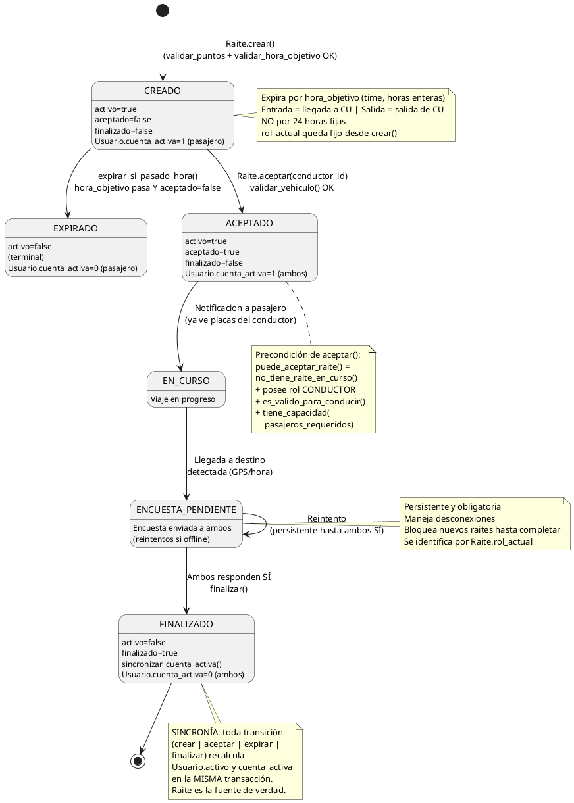
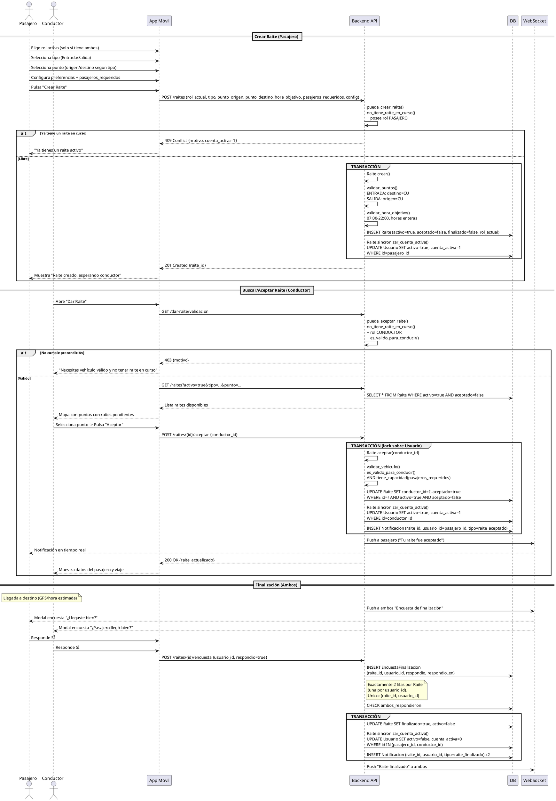

# **Raite - Documento de Layout y Disposición (Mejorado)**

---

## **FLUJOS DE USUARIO**

### **Autenticación**
| Pantalla | Campos | Notas |
|----------|--------|-------|
| **Login** | Correo, Contraseña | Autenticación estándar |
| **Registro - Paso 1** | Nombre completo, Correo, Contraseña, **Rol(es)** | Usuario elige: **Pasajero**, **Conductor**, o **Ambos** (marca ambos = 2 filas en `UsuarioRol`) |
| **Registro - Paso 2 (Condicional)** | **Datos del Vehículo** | **Solo si posee el rol `CONDUCTOR`** (directo o vía "Ambos") |

> **Campos del Vehículo (Paso 2):**
> - Marca
> - Modelo
> - Color
> - Placas
> - Tipo de vehículo: `Camioneta` / `Coche` / `Troca`
> - Número de asientos disponibles para pasajeros
> - `activo` (bool, por defecto `true`): lo controla el Admin. `activo=false` → `es_valido_para_conducir()` = `false` y el modo "Dar Raite" queda bloqueado

> **Reglas de negocio:**
> - Los pasajeros solo ven la placa del conductor **después de aceptar** el viaje
> - **El pasajero solo puede pedir raite en puntos del catálogo** (ver Catálogo de Puntos de Raite). No se admiten coordenadas libres
> - **El conductor solo ve los puntos con raites activos**: el mapa nunca muestra el catálogo completo, solo los puntos donde hay alguien esperando
> - **Entrada**: Recogida = Punto del catálogo (seleccionable), Destino = **CU** (fijo)
> - **Salida**: Recogida = **CU** (fijo), Destino = Punto del catálogo (seleccionable)
> - Usuario con ambos roles ve ambas interfaces. El rol elegido se persiste en `Raite.rol_actual` (propiedad del viaje, no del usuario)
> - Perfil de conductor **requiere vehículo válido** (`Vehiculo.es_valido_para_conducir()`) para activar modo "Dar Raite"
> - **`activo` y `cuenta_activa` son caché, no fuente de verdad.** La verdad es `Raite.activo/aceptado/finalizado`; solo `Raite.sincronizar_cuenta_activa()` los escribe
> - Nunca editar `activo`/`cuenta_activa` desde la API: se hace dentro de la transacción de la transición que los dispara

---

### **CATÁLOGO DE PUNTOS DE RAITE**

Los puntos **no son coordenadas libres**: es un **catálogo cerrado** de comercios de la ciudad, cargado por el Admin. El pasajero **elige de este catálogo**; el sistema no permite marcar un punto arbitrario en el mapa.

| `nombre_punto` | Tipo | Sucursales | Notas |
|----------------|------|------------|-------|
| **Walmart** | Supermercado | Varias | |
| **S-Mart** | Supermercado | Varias | |
| **Sam's** | Supermercado | Varias | Club de socios, revisar acceso |
| **Soriana** | Supermercado | Varias | |
| **Oxxo** | Tienda de conveniencia | Varias | |
| **Aurrerá** | Supermercado | Varias | |
| **Superette** | Supermercado | Varias | |
| **Del Río** | Supermercado | Varias | |
| **Extra** | Hipermercado | Varias | |
| **Circle K** | Tienda de conveniencia | Varias | |

> **Reglas del catálogo:**
> - **Cada sucursal es una fila** en `PuntoMapeado`. Como el modelo solo tiene `nombre_punto` + `latitud`/`longitud`, dos sucursales de la misma cadena **deben** diferenciarse en el nombre: `Soriana - Centro`, `Soriana - Norte`. Sin eso se colisionan
> - `nombre_punto` es único junto a `activo`; el `nombre_punto` visible se muestra normalizado (`Aurrerá`, `Del Río`, `Circle K`) aunque el identificador de carga sea plano (`aurrera`, `del_rio`, `circlek`)
> - `activo=false` saca el punto del mapa del pasajero sin borrar el historial de raites ya asociados
> - El **CU** es un punto del sistema más, fijo, y **no** aparece en el catálogo seleccionable
> - Alta y edición: solo Admin (Panel de Administración → Puntos de Raite). Carga inicial por *seed*/migración

---

### **MAPAS, GEOCODIFICACIÓN Y RASTREO EN VIVO**

Esta sección recoge la implementación técnica de los mapas, la geocodificación del catálogo de puntos y el seguimiento GPS en tiempo real durante los viajes activos.

#### **Poblado de la Base de Datos (Catálogo de Puntos)**

De acuerdo a la arquitectura, los puntos de Raite son estáticos y provienen de un catálogo cerrado. Se utilizará **Overpass Turbo** para la extracción inicial y un script *seed* para llenar la tabla `PuntoMapeado`.

##### **Consulta en Overpass Turbo**
Ve a [overpass-turbo.eu](https://overpass-turbo.eu/) y ejecuta la siguiente consulta. Este ejemplo extrae todos los "Oxxo" en Ciudad Juárez. (Deberás repetir o agrupar la consulta para Walmart, S-Mart, etc.).

```text
[out:json][timeout:25];
// Definir el área de búsqueda (Ciudad Juárez)
area["name"="Ciudad Juárez"]->.searchArea;
(
  // Buscar nodos (puntos simples)
  node["name"~"Oxxo", i](area.searchArea);
  // Buscar vías/polígonos (edificios)
  way["name"~"Oxxo", i](area.searchArea);
);
// 'out center' convierte los polígonos en un solo punto central (lat/lon)
out center;
```

##### **Procesamiento y Seed (Migración)**
Exporta el resultado como **JSON**. El JSON resultante tendrá una estructura con elementos (`elements`). Debes iterar sobre ellos en tu script de backend (ej. Django/Node) para llenar la base de datos.

**Lógica del Seed:**
1. Iterar sobre `elements` del JSON.
2. Si es tipo `node`, usar `lat` y `lon`. Si es tipo `way`, usar `center.lat` y `center.lon`.
3. **Resolución de colisiones:** Como `nombre_punto` debe ser único, debes concatenar la calle o colonia (que a menudo viene en el objeto `tags` de Overpass) para diferenciar sucursales. Ej: `tags.name + " - " + tags['addr:street']` -> *"Oxxo - Avenida Tecnológico"*.
4. Insertar en `PuntoMapeado` con `activo = true`.

---

#### **Uso de Leaflet y Seguimiento Live (GPS)**

El rastreo en vivo se usa una vez que el Raite pasa a estado `ACEPTADO`. Se requiere la API de Geolocalización de HTML5 en el frontend y WebSockets para compartir la ubicación.

##### **Renderizado Básico con Leaflet**
Para mostrar el catálogo o los viajes pendientes:

```javascript
// Inicializar mapa centrado en CU / Ciudad Juárez
const map = L.map('mapa').setView([31.6904, -106.4245], 13);
L.tileLayer('https://{s}.tile.openstreetmap.org/{z}/{x}/{y}.png').addTo(map);

// Agregar un punto estático de la BD
const marcadorOxxo = L.marker([latBD, lonBD]).addTo(map);
marcadorOxxo.bindPopup("Oxxo - Tecnológico (2 esperando)");
```

##### **Seguimiento Live GPS del Dispositivo**
Lógica exclusiva para el **Conductor** (para emitir) y el **Pasajero** (para recibir).

```javascript
let marcadorConductor;
let watchId;

// INICIAR RASTREO (Se ejecuta en el celular del Conductor)
function iniciarRastreo(raiteId) {
    if (!navigator.geolocation) return alert("GPS no soportado");

    watchId = navigator.geolocation.watchPosition(
        (position) => {
            const { latitude, longitude } = position.coords;
            
            // 1. Actualizar Leaflet localmente
            if (!marcadorConductor) {
                marcadorConductor = L.marker([latitude, longitude]).addTo(map);
            } else {
                marcadorConductor.setLatLng([latitude, longitude]);
            }
            map.setView([latitude, longitude]); // Centrar mapa

            // 2. Enviar por WebSocket al backend
            socket.send(JSON.stringify({
                tipo: 'ubicacion_conductor',
                raite_id: raiteId,
                lat: latitude,
                lon: longitude
            }));
        },
        (error) => console.error("Error GPS:", error),
        { enableHighAccuracy: true, maximumAge: 0 }
    );
}

// DETENER RASTREO (Al llegar al destino o finalizar)
function detenerRastreo() {
    if (watchId) navigator.geolocation.clearWatch(watchId);
}
```

---

#### **Actualizaciones al Diagrama de Clases UML**

Para soportar el rastreo en vivo sin sobrecargar la base de datos relacional (no debes guardar cada coordenada en SQL por segundo), debes modelar una interfaz de **WebSocket/Caché**.

**Atributos en `Raite`:**
* No agregues `lat/lon` actual a la tabla `Raite` si cambia cada segundo. Usa la base de datos solo para persistir estados.

**Nueva Clase Transitoria (WebSocket Manager / Redis):**
Añade una clase `GestorUbicacionLive` (representa el canal WebSocket/Caché) con estereotipo `<<Transient>>` o `<<Service>>`.

```plantuml
class GestorUbicacionLive <<Service>> {
  + conectar_cliente(usuario_id, raite_id)
  + actualizar_ubicacion(raite_id, conductor_id, latitud, longitud)
  + notificar_pasajero(raite_id, latitud, longitud)
  + desconectar_cliente(usuario_id)
}
```

**Nuevos Métodos en el Frontend (App/UI):**
Si tu UML modela la aplicación cliente, agrega:

```plantuml
class AppMovil {
  + watch_id: Integer
  + iniciar_rastreo_gps(raite_id): void
  + detener_rastreo_gps(): void
  + actualizar_mapa_leaflet(latitud, longitud): void
}
```

**Relaciones a Agregar en el UML:**
* `GestorUbicacionLive` ---> `Raite` : Lee estado (valida que esté `ACEPTADO` y `EN_CURSO`)
* `AppMovil` ---> `GestorUbicacionLive` : Emite/Escucha eventos por WebSocket
* `AppMovil` ---> `PuntoMapeado` : Renderiza marcadores estáticos en Leaflet

---

### **PANTALLA HOME**

#### **Panel 1 - Selección de Viaje y Rol Activo**
| Elemento | Tipo | Opciones | Notas |
|----------|------|----------|-------|
| Tipo de viaje | Radio/Select | `Entrada` (a la escuela) / `Salida` (de la escuela) | Requerido |
| **Rol activo** | Toggle / Segmented Control | `Pasajero` / `Conductor` | **Solo si usuario tiene ambos roles**; si solo tiene uno, se oculta y usa ese rol |

---

#### **Panel 2 - Tarjetas de Estado Dinámico**

| Estado | Disparador | Datos mostrados |
|--------|------------|-----------------|
| **🟢 "¡Hola! Solicita un raite"** | Pasajero sin solicitud activa | Estado vacío con CTA a "Pedir Raite" |
| **🔵 "¡Han solicitado ser tu raite!"** | Conductor recibe solicitud | **Datos del Conductor** + **Datos del Viaje** (ver abajo) |
| **🟡 "¡Han aceptado tu raite!"** | Solicitud del pasajero aceptada | **Datos del Pasajero** + **Datos del Viaje** |
| **🟣 "¡Tienes un raite programado!"** | Viaje confirmado (ambas partes) | **Datos del Contraparte** + **Datos del Viaje** |

---

#### **Estructuras de Datos**

**Roles (`UsuarioRol`):**
- Un usuario tiene **N** filas: `PASAJERO`, `CONDUCTOR`, `ADMIN`
- **Único** por `(usuario_id, rol)` — no puede haber duplicados
- **"Ambos" no es un valor almacenado**: es un usuario con filas `PASAJERO` + `CONDUCTOR`
- Un `ADMIN` no requiere `Vehiculo`; un `CONDUCTOR` sí

**Perfil de Conductor:**
- Nombre, Edad, Sexo, Carrera
- Calificación (★ 1-5)
- **Vehículo** (0..1, obligatorio para dar raite):
  - Marca, Modelo, Color, Placas
  - Tipo: `Camioneta` / `Coche` / `Troca`
  - Asientos disponibles para pasajeros
- Preferencias de viaje
- **`activo` (bool, caché):** `true` si tiene un Raite en curso (aceptado y no finalizado)
- **`cuenta_activa` (Integer, caché):** nº de Raites en curso. Invariante `0..1` (`0` = libre, `1` = ya está en un viaje). No es un `Boolean`

**Perfil de Pasajero:**
- Nombre, Edad, Sexo, Carrera
- Calificación (★ 1-5)
- Preferencias de viaje
- **`activo` (bool, caché):** `true` si tiene un Raite en curso (creado/aceptado y no finalizado)
- **`cuenta_activa` (Integer, caché):** nº de Raites en curso. Invariante `0..1` (`0` = libre, `1` = ya está en un viaje). No es un `Boolean`

**Raite:**
- `pasajero_id` (FK)
- `conductor_id` (FK, nullable hasta aceptación)
- `rol_actual`: rol con el que actúa en este viaje (solo si el usuario tiene ambos roles)
- `tipo`: `Entrada` / `Salida`
- **Entrada**: `punto_recogida` (sistema) → `punto_destino` = **CU** (fijo)
- **Salida**: `punto_recogida` = **CU** (fijo) → `punto_destino` (sistema)
- `hora_objetivo` (time, solo horas enteras: 07:00–22:00)
  - **Entrada**: hora de **llegada a CU** (deadline)
  - **Salida**: hora de **salida de CU** (cuándo parten)
- `pasajeros_requeridos`: se valida contra `Vehiculo.asientos_disponibles` al aceptar
- `configuracion`: mismo sexo, usar cajuela, mascotas, etc.
- **Estados (bool):**
  - `activo`: `true` al crear, `false` si expira por hora o se finaliza
  - `aceptado`: `false` inicial, `true` cuando conductor acepta
  - `finalizado`: `false` inicial, `true` tras encuesta **ambos**
- `created_at`, `updated_at`

> **Regla de expiración (Entrada):** Si `hora_objetivo` (llegada a CU) pasa y `aceptado=false` → `activo=false`
> 
> **Regla de expiración (Salida):** Si `hora_objetivo` (salida de CU) pasa y `aceptado=false` → `activo=false`
>
> **Toda transición pasa por `sincronizar_cuenta_activa()`:** `crear`, `aceptar`, `expirar_si_pasado_hora` y `finalizar` recalculan `activo`/`cuenta_activa` de ambos usuarios dentro de la **misma transacción**. Si esa llamada falla, la transición entera revierte: no puede quedar un Raite activo con un usuario libre, ni al revés.
>
> **Finalización obligatoria:** Encuesta persistente (reintenta si offline). Ambos deben responder `sí` → `finalizado=true`, `activo=false`, libera `activo` y `cuenta_activa` en ambos perfiles vía `sincronizar_cuenta_activa()`.
>
> *Placas visibles solo tras `aceptado=true`*

---

### **PEDIR RAITE (Pasajero) — Crea un RAITE**

| Paso | Componente | Descripción |
|------|------------|-------------|
| 1 | **Vista de Mapa** (panel derecho) | Mapa con los **puntos del catálogo** (Walmart, S-Mart, Sam's, Soriana, Oxxo, Aurrerá, Superette, Del Río, Extra, Circle K) como marcadores seleccionables. Solo se muestran los que tienen `activo=true`<br>**Entrada**: el punto elegido es el de **recogida**<br>**Salida**: el punto elegido es el de **destino** (recogida fija en CU) |
| 2 | **Botón "Dar Raite"** | Invoca `Raite.crear()` con: `rol_actual` (si el usuario tiene ambos roles), `hora_objetivo` (time, horas enteras), `tipo`, `punto_origen`, `punto_destino`, `pasajeros_requeridos`, `configuracion`<br>**Validaciones:** `validar_puntos()` (CU fijo según `tipo` + ambos extremos en el catálogo) + `validar_hora_objetivo()` (07:00–22:00)<br>**Atributos del Raite:** `aceptado` (bool), `finalizado` (bool), `activo` (bool) |
| 3 | **Panel de Detalle del Punto** (panel izquierdo) | Nombre del comercio y sucursal, coordenadas, conductores cercanos, ETA |

> **Ciclo de vida del Raite:**
> - `activo=true` al crearse (y `sincronizar_cuenta_activa()` marca al pasajero)
> - **Entrada**: Si nadie acepta antes de `hora_objetivo` (llegada a CU) → `activo=false`
> - **Salida**: Si nadie acepta antes de `hora_objetivo` (salida de CU) → `activo=false`
> - Si conductor acepta → `aceptado=true`, se notifica a pasajero
> - **Finalización:** Ambos (pasajero + conductor) responden encuesta obligatoria y persistente → `finalizado=true`
> - **Sincronía:** las 4 transiciones (`crear`, `aceptar`, `expirar_si_pasado_hora`, `finalizar`) escriben `activo`/`cuenta_activa` **solo** vía `sincronizar_cuenta_activa()`
> - **Bloqueo:** `no_tiene_raite_en_curso()` debe ser `true` para crear o aceptar (invariante `cuenta_activa <= 1`). **Ojo con concurrencia:** un `if` no basta, dos peticiones simultáneas pueden pasar el filtro a la vez. Requiere índice único parcial o lock pesimista sobre `Usuario`
> - **`rol_actual` es inmutable** una vez creado el Raite: define contra qué rol se valida la encuesta y qué interfaz ve cada parte

---

### **DAR RAITE (Conductor)**

| Paso | Componente | Descripción |
|------|------------|-------------|
| 1 | **Vista de Mapa** (panel derecho) | **Solo los puntos con raites activos.** El conductor nunca ve el catálogo completo: el mapa se construye desde los raites pendientes, no desde el catálogo<br>**Entrada**: marcadores en los puntos de **recogida** con raites activos<br>**Salida**: marcadores en los puntos de **destino** con raites activos (recogida en CU)<br>Cada marcador muestra **nombre del comercio**, nº de raites esperando y `hora_objetivo` más próxima |
| 2 | **Botón Aceptar** | Invoca `Raite.aceptar(conductor_id)`: setea `aceptado=true`, vincula conductor, `validar_vehiculo()`, notifica al pasajero y sincroniza `cuenta_activa` |

> **Mapa del conductor (`GET /dar-raite/mapa?tipo=...`):**
> Devuelve **únicamente** los `PuntoMapeado` con al menos un `Raite` `activo=true` y `aceptado=false`, agrupados por punto, con el número de raites esperando y la `hora_objetivo` más próxima. **Nunca consulta el catálogo completo**: un punto sin raites no aparece en el mapa, aunque esté activo en el catálogo. El mapa del conductor es un subconjunto del del pasajero

> **Validación previa (`puede_aceptar_raite()`):**
> - `no_tiene_raite_en_curso()` → `cuenta_activa == 0` (y lock para evitar carrera)
> - Posee el rol `CONDUCTOR` en `UsuarioRol`
> - `Vehiculo.es_valido_para_conducir()` → existe, completo y activo
> - `Vehiculo.tiene_capacidad(Raite.pasajeros_requeridos)` → hay asientos libres

---

## **PANEL DE ADMINISTRACIÓN**

| Sección | Funcionalidades |
|---------|-----------------|
| **Usuarios** | Listar todos / filtrar por rol vía `UsuarioRol` (Pasajero/Conductor/Admin), búsqueda, paginación. Filtro "Ambos" = usuarios con ambas filas |
| **Puntos de Raite** | CRUD del catálogo + filtrar por cadena, zona, `activo`. Alta por sucursal, no solo por cadena |
| **Raites Pedidos** | Filtrar por fecha, estado, usuario, punto |
| **Raites Programados** | Igual que anterior + `aceptado=true` (no hay campo `status`: el estado son los bools `activo`/`aceptado`/`finalizado`) |
| **Vehículos** | CRUD + filtrar por tipo, capacidad, conductor + **activar/desactivar** (`Vehiculo.activo`); un vehículo `activo=false` es inválido y no habilita el modo "Dar Raite" |

---

## **NOTAS TÉCNICAS / PENDIENTES**

- [x] **Integración Leaflet**: Los puntos son **POIs pre-mapeados** de un catálogo cerrado (10 cadenas), no coordenadas libres. Solo el Admin los da de alta. Ver **MAPAS, GEOCODIFICACIÓN Y RASTREO EN VIVO**
- [ ] **Cargar catálogo de sucursales**: *seed* de `PuntoMapeado` con `latitud`/`longitud` reales de cada sucursal. **Procedimiento definido** (extracción con Overpass Turbo + script de seed), **pendiente de ejecutar** sobre las 10 cadenas y sus sucursales en Ciudad Juárez
- [x] **Distinguir sucursales**: `nombre_punto` compuesto (`Soriana - Centro`) built desde `tags.name + tags['addr:street']` de Overpass, para evitar colisiones; queda pendiente un identificador de sucursal propio si se requiere
- [ ] **Guardias de Autenticación**: Protección de rutas por rol — la fuente es `UsuarioRol` (filas), no un enum. Un admin pasa si posee la fila `ADMIN`; "ambos roles" = tiene `PASAJERO` **y** `CONDUCTOR`
- [ ] **Django Admin**: Personalizar admin por defecto para modelos de Raite
- [x] **Diagrama UML**: Generado desde esta especificación (Clases, Estados, Secuencia crear/aceptar, Secuencia expiración). Incluye `GestorUbicacionLive` y `AppMovil` para el rastreo GPS
- [ ] **Sincronía de flags**: `activo`/`cuenta_activa` son caché de `Raite`. Definir la transacción compartida y garantizar el **índice único parcial o lock pesimista** que impide dos raites concurrentes con `no_tiene_raite_en_curso()`
- [ ] **Tiempo Real**: Estrategia WebSocket para solicitudes/actualizaciones de viajes. El mapa del conductor debe refrescarse al crearse/expirarse un raite, no solo al abrir la pantalla. El rastreo GPS ya está modelado con `GestorUbicacionLive` (WebSocket + caché, sin persistir coordenadas en SQL)
- [ ] **Notificaciones**: Push + in-app para cambios de estado de viaje (`Notificacion` referencia `raite_id` + `usuario_id`)

---

## **MEJORAS UI/UX (Sugeridas)**

1. **Skeleton Loaders** para mapa y paneles de datos
2. **Estados Vacíos** con ilustraciones para cada estado del panel
3. **Notificaciones Toast** para actualizaciones de viaje (solicitado, aceptado, cancelado)
4. **Bottom Sheet** para detalles de viaje en móvil (en lugar de panel lateral)
5. **Seguimiento ETA Conductor** en vivo en pantalla "Tienes un raite programado"
6. **Modal de Calificación** post-viaje (ambas partes)

---

*Generado desde `Raite_layout_disposition.md` — Original conservado*

---

## **DIAGRAMAS UML**

### **1. Diagrama de Clases**

```plantuml
@startuml
skinparam classAttributeIconSize 0

enum Rol {
  PASAJERO
  CONDUCTOR
  ADMIN
}

enum TipoViaje {
  ENTRADA
  SALIDA
}

enum TipoVehiculo {
  CAMIONETA
  COCHE
  TROCA
}

class Usuario {
  + id: UUID
  + nombre: String
  + apellidos: String
  + correo: String (unique)
  + password_hash: String
  + edad: Integer
  + sexo: String
  + carrera: String
  + calificacion: Float (1-5)
  + activo: Boolean
  + cuenta_activa: Integer  -- nº de Raites en curso, invariante 0..1
  + created_at: DateTime
  + updated_at: DateTime
  + refrescar_cuenta_activa(): void
  + puede_crear_raite(): Boolean
  + puede_aceptar_raite(): Boolean
  + no_tiene_raite_en_curso(): Boolean
}

class UsuarioRol {
  + id: UUID
  + usuario_id: UUID (FK)
  + rol: Rol
}

class Vehiculo {
  + id: UUID
  + usuario_id: UUID (FK)
  + marca: String
  + modelo: String
  + color: String
  + placas: String (unique)
  + tipo: TipoVehiculo
  + asientos_disponibles: Integer
  + activo: Boolean  -- false = invalidado (sin placas,revision,etc)
  + created_at: DateTime
  + es_valido_para_conducir(): Boolean
  + tiene_capacidad(requeridos: Integer): Boolean
}

class PuntoMapeado {
  + id: UUID
  + nombre_punto: String
  + latitud: Float
  + longitud: Float
  + activo: Boolean
}

class Raite {
  + id: UUID
  + pasajero_id: UUID (FK)
  + conductor_id: UUID (FK, nullable hasta aceptación)
  + rol_actual: Rol
  + tipo: TipoViaje
  + punto_origen_id: UUID (FK)
  + punto_destino_id: UUID (FK)
  + hora_objetivo: Time  -- solo horas enteras (07:00–22:00)
  + pasajeros_requeridos: Integer
  + configuracion: JSON
  + activo: Boolean
  + aceptado: Boolean
  + finalizado: Boolean
  + created_at: DateTime
  + updated_at: DateTime
  + crear(pasajero_id, rol_actual, tipo, punto_origen_id, punto_destino_id, hora_objetivo, pasajeros_requeridos, configuracion): Raite
  + validar_puntos(tipo): void
  + validar_hora_objetivo(hora_objetivo): void
  + validar_vehiculo(conductor_id): void
  + expirar_si_pasado_hora(): void
  + aceptar(conductor_id): void
  + finalizar(encuesta_pasajero, encuesta_conductor): void
  + sincronizar_cuenta_activa(): void
}

class EncuestaFinalizacion {
  + id: UUID
  + raite_id: UUID (FK)
  + usuario_id: UUID (FK)
  + respondio: Boolean?  -- null=pendiente, true=sí, false=no
  + respondio_en: DateTime?
  + reintentos: Integer
}

class Notificacion {
  + id: UUID
  + raite_id: UUID (FK, nullable si es aviso de sistema)
  + usuario_id: UUID (FK)
  + tipo: String (raite_creado, raite_aceptado, raite_finalizado, etc.)
  + titulo: String
  + mensaje: String
  + leida: Boolean
  + created_at: DateTime
}

class GestorUbicacionLive <<Service>> {
  + conectar_cliente(usuario_id, raite_id): void
  + actualizar_ubicacion(raite_id, conductor_id, latitud, longitud): void
  + notificar_pasajero(raite_id, latitud, longitud): void
  + desconectar_cliente(usuario_id): void
}

class AppMovil <<Client>> {
  + watch_id: Integer
  + iniciar_rastreo_gps(raite_id): void
  + detener_rastreo_gps(): void
  + actualizar_mapa_leaflet(latitud, longitud): void
}

Usuario "1" -- "0..1" Vehiculo : requiere_para_conducir >
Usuario "1" -- "*" UsuarioRol : posee >
Usuario "1" -- "*" Raite : como_pasajero >
Usuario "0..1" -- "*" Raite : como_conductor >
Usuario "1" -- "*" Notificacion : recibe >
Usuario "1" -- "0..2" EncuestaFinalizacion : responde >
Raite "1" -- "1" PuntoMapeado : origen >
Raite "1" -- "1" PuntoMapeado : destino >
Raite "1" -- "2" EncuestaFinalizacion : genera_requiere_ambos >
Raite "1" -- "*" Notificacion : dispara >
GestorUbicacionLive --> "0..1" Raite : lee_estado >
AppMovil --> GestorUbicacionLive : emite_escucha_websocket >
AppMovil --> PuntoMapeado : renderiza_marcadores >
AppMovil --> Raite : opera >
AppMovil --> Usuario : autentica >

note right of Rol
  Un usuario con PASAJERO y CONDUCTOR
  (dos filas en UsuarioRol) es "AMBOS"
  en la interfaz. No es un valor del enum.
end note

note right of UsuarioRol
  Unico: (usuario_id, rol)
end note

note right of Usuario::activo
  true = tiene Raite en curso
  (activo=true Y finalizado=false)
  Bloquea crear/aceptar nuevo
  CACHE: Raite es la fuente de verdad.
  Se refresca solo desde Raite.
end note

note right of Raite::activo
  true al crear
  false si expira hora_objetivo sin aceptar
  false al finalizar (encuesta ambos)
end note

note bottom of Raite::sincronizar_cuenta_activa
  Recalcula Usuario.activo y
  Usuario.cuenta_activa en la MISMA
  transaccion. La invocan TODAS las
  transiciones:
  crear | aceptar | expirar_si_pasado_hora
  | finalizar
end note

note bottom of Usuario::puede_crear_raite
  true solo si:
  - no_tiene_raite_en_curso()
  - posee el rol correspondiente
  (Conductor: ademas vehiculo valido)
end note

note bottom of Usuario::no_tiene_raite_en_curso
  Invariante: cuenta_activa <= 1
  Exige indice unico parcial o lock
  pesimista sobre Usuario: dos peticiones
  concurrentes pueden pasar el "if" a
  la vez. Sin eso hay carrera.
end note

note bottom of Raite::validar_vehiculo
  Precondicion de aceptar():
  Vehiculo.es_valido_para_conducir()
  y tiene_capacidad(pasajeros_requeridos)
end note

note bottom of Raite::validar_puntos
  ENTRADA: punto_destino = CU
  SALIDA:  punto_origen = CU
  El otro extremo sale del CATALOGO
  de puntos (activo=true) y es
  eleccion del pasajero. No se
  admiten coordenadas libres.
end note

note bottom of Notificacion::usuario_id
  Destinatario (FK) y la relacion
  Raite->Notificacion son info
  redundante: deben mantenerse
  coherentes en la misma transaccion.
end note

note bottom of Notificacion::raite_id
  FK real a Raite. Obligatorio para
  toda notificacion de viaje; solo
  nullable en avisos de sistema
  (sin raite asociado). Unique
  no aplica: un Raite genera N
  Notificaciones (creado, aceptado,
  expirado, finalizado).
end note

note right of Usuario::cuenta_activa
  Integer, NO Boolean: es el numero
  de Raites en curso. Invariante
  0..1 (cache). 0 = libre,
  1 = ya esta en un viaje.
  Derivada de Raite, nunca escrita
  fuera de sincronizar_cuenta_activa().
end note

note bottom of Vehiculo::activo
  Soporta la validacion "existe,
  completo y activo" de
  es_valido_para_conducir().
  false = invalido (sin placas,
  datos incompletos o dado de
  baja) -> no puede dar raite.
end note

note bottom of GestorUbicacionLive
  <<Service>> TRANSIENTE: no es
  tabla. WebSocket + cache/Redis.
  NO persiste cada coordenada en
  SQL: solo valida que el Raite
  este ACEPTADO / EN_CURSO y
  reenvia lat/lon al pasajero.
  La DB guarda estados, no GPS.
end note

@enduml
```

---

### **2. Diagrama de Estados del Raite**



---

### **3. Diagrama de Secuencia: Crear y Aceptar Raite**



---

### **4. Diagrama de Secuencia: Expiración por Tiempo**

```plantuml
@startuml
actor "Scheduler/Cron" as Cron
participant "Backend API" as API
participant "DB" as DB
participant "WebSocket" as WS
actor Pasajero

Cron -> API: Cada 5 min: GET /raites/expirados
API -> DB: SELECT * FROM Raite WHERE activo=true AND aceptado=false AND hora_objetivo < CURRENT_TIME
DB --> API: Lista raites expirados
loop Para cada raite expirado
  group TRANSACCIÓN
    API -> API: Raite.expirar_si_pasado_hora()
    API -> DB: UPDATE Raite SET activo=false WHERE id=?
    API -> DB: Raite.sincronizar_cuenta_activa()\nUPDATE Usuario SET activo=false, cuenta_activa=0\nWHERE id=pasajero_id
    API -> DB: INSERT Notificacion (raite_id, usuario_id=pasajero_id, tipo=raite_expirado)
  end
  API -> WS: Push "Raite expirado" a pasajero
  WS --> Pasajero: "Ningún conductor aceptó a tiempo"
end

note bottom of API
  La caché Usuario.activo/cuenta_activa
  solo se escribe aquí y en
  crear/aceptar/finalizar, siempre
  en la misma transacción que el
  cambio de Raite. Un fallo revierte
  ambas: nunca queda un Raite activo
  con un usuario libre, ni al revés.
end note
@enduml
```

---

*Documento completo con UML generado. Original en `Raite_layout_disposition.md` conservado.*